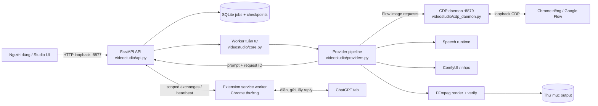
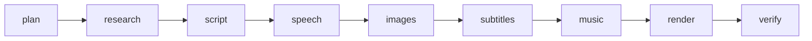

# VideoStudio

Ứng dụng local trên Windows để tạo và quản lý video theo dự án. Server và worker chạy trên máy người dùng; ảnh Flow dùng Chrome riêng; ChatGPT text dùng extension trên Chrome thường; file xuất mặc định lưu ở `E:\Videos`.

## Cài trên máy Windows mới

Trên máy hiện tại có thể bấm đúp **VideoStudio.exe** trong thư mục dự án. Cửa sổ Windows hiển thị trạng thái Studio/Flow/ComfyUI, có nút **Mở hệ thống**, **Khởi động lại**, **Dừng hệ thống** và **Vào Studio**. Giao diện tạo video mở trong Chrome thường để dùng extension bridge. Đóng launcher không dừng video; các nút dừng/restart vẫn kiểm tra job đang chạy.

`VideoStudio.exe` là launcher, cần đặt cùng thư mục source (bên cạnh `scripts/`). Nó dùng lại Python, Chrome, ComfyUI và model đã cài; không chứa các runtime/model lớn. Repo có sẵn file exe để dùng sau khi clone. Để build lại sau khi cập nhật source launcher:

```powershell
python -m pip install pyinstaller
powershell -NoProfile -ExecutionPolicy Bypass -File scripts/build_windows_launcher.ps1
```

Nhật ký thao tác trong app: `data/launcher.log`. Bộ khởi động `.cmd` bên dưới vẫn dùng được độc lập.

1. Cài Git, Python 3.12 x64, Google Chrome và FFmpeg (`ffmpeg`, `ffprobe` phải có trong `PATH`). Runtime/model/cache giọng đọc và ComfyUI là phần cài riêng; requirements không tự tải model lớn.

```powershell
git clone https://github.com/trinhmanhviet/videostudio.git D:\Projects\videostudio
Set-Location D:\Projects\videostudio
py -3.12 -m venv .venv
.\.venv\Scripts\Activate.ps1
python -m pip install --upgrade pip
python -m pip install -r requirements.txt
```

Nếu chưa có `py -3.12`, cài Python 3.12 trước. Launcher dùng `C:\Python312\python.exe` nếu có, nếu không dùng Python đầu tiên trong `PATH`.

2. Nạp extension: Chrome thường → `chrome://extensions` → bật Developer mode → **Load unpacked** → chọn `D:\Projects\videostudio\extensions\videostudio-chatgpt`.
3. Đăng nhập Google qua `Chrome - Clean.cmd`; sau đó mở **Mở debug** trong float để Flow cho phép tool điều khiển.
4. Bấm đúp **Start VideoStudio.cmd**. Mở Studio, đăng nhập ChatGPT trong Chrome thường. Trong float bấm **Start**, rồi **Test chữ** nếu bridge chưa kết nối. Muốn tắt hoặc khởi động lại hệ thống, dùng **Stop VideoStudio.cmd** hoặc **Restart VideoStudio.cmd**.

Muốn tự mở Chrome riêng: dùng **Chrome - Clean.cmd** để đăng nhập bình thường; **Chrome - Debug.cmd** để điều khiển Flow; **Chrome - Stop.cmd** để tắt Chrome riêng. Cả ba cùng dùng `data/chrome-profile`, giữ tài khoản và dữ liệu. Chế độ sạch để đăng nhập; debug để điều khiển. Không đổi chế độ khi video hoặc tác vụ ảnh đang chạy.

Chrome debug dùng cổng local cố định `19223` và không thêm `--enable-automation`; người dùng đã xác nhận tạo ảnh Flow thủ công thành công với cấu hình này. Tool xác nhận executable/profile, PID, thời điểm khởi động và listener loopback, rồi kiểm tra lại sau khi nối WebSocket. Không sửa `navigator.webdriver`. Cổng bị tiến trình khác chiếm sẽ báo lỗi, không dừng tiến trình đó. Có thể đặt `VS_CHROME_DEBUG_PORT` thành một cổng trống từ 1024 đến 65535; dùng cùng giá trị cho backend, daemon và lệnh mở Chrome. Chrome cũ dùng cổng tự chọn được giữ kết nối nếu khớp PID/listener và token; lần mở debug mới dùng cổng cố định.

ComfyUI nếu đã chạy được mở bởi shortcut của người dùng thì launcher sẽ dùng lại. Nếu chưa chạy, launcher gọi `scripts/start_comfy_recovery.py`, cần có cấu hình launcher/runtime hợp lệ trên máy đó. Launcher này không cài ComfyUI, model, node hay tài khoản. Khởi động backend thủ công:

```powershell
Set-Location D:\Projects\videostudio
python -m uvicorn videostudio.api:app --host 127.0.0.1 --port 8877
```

## Bàn dựng mới và Workflow canvas — UI tùy chọn

**UI cũ được giữ nguyên.** Bản dựng kiểu mới không thay form tạo video, float hay editor ảnh từng cảnh hiện hành. Có thêm bàn dựng với media/preview/inspector/timeline nhiều lớp, `edit_plan.json`, ba preset, nhạc theo chương, SFX và canvas kéo/nối/cấu hình workflow.

Đã kiểm tra 619 Python + 139 JavaScript test, xuất MP4 thật từ editor và kéo/nối/cấu hình/lưu/Run workflow trên fixture riêng. Không cần build frontend hoặc reload extension; sau khi cập nhật/nạp backend lúc rảnh, F5 Studio để thấy nút mới. Nghiệm thu video AI dài và restart máy vẫn do người dùng thực hiện riêng.

- [Tài liệu bàn dựng mới và Workflow](docs/editor-workflow.md): hướng dẫn, trạng thái nghiệm thu, thiết kế, schema/API, sơ đồ kỹ thuật, cache và các việc còn lại trong một file.

Các hành vi dựng tự động mới chỉ bật khi chủ động opt-in bằng `edit_preset`/`workflow` hoặc các tùy chọn node tương ứng. Request từ UI cũ không tự bị đổi sang preset hay cách tạo nhạc mới. Bản xuất editor tạo child render-only job, dùng lại media và giữ video cũ.

## Thử Flow bằng request qua extension

Đường thử mới nằm trong **extension VideoStudio hiện có**, bật qua popup icon extension và quyền Flow tùy chọn. Chạy `Start Flow Request.cmd`, mở `http://localhost:8878/flow-request`, ghép mã kết nối rồi thử liệt kê dự án trước. Không cần cài extension thứ hai, xuất cookie hay restart backend đang chạy. Hướng dẫn đầy đủ và giới hạn nghiệm thu: [FlowAPI/README.md](FlowAPI/README.md). Các video hiện tại vẫn dùng provider Flow cũ; tạo ảnh bằng request chưa được mặc định bật.

## Tạo và phục hồi video

Nghiệm thu ngày 2026-11-03: người dùng đã tạo thành công video 8 giây bằng tool sau bản CDP cổng cố định. Video dài hơn vẫn đang chờ nghiệm thu. Đây là luồng Flow qua trình duyệt/giao diện; nhánh thử nghiệm FlowAPI request trực tiếp vẫn chưa tạo ảnh thành công.

- Kế hoạch sản xuất mới tự chia cảnh theo nội dung/bối cảnh: nhiều câu có thể dùng chung một ảnh; đổi địa điểm, thời gian, nhân vật chính hoặc hành động thì đổi cảnh. Lời đọc và phụ đề vẫn có timing riêng theo từng câu. Áp dụng cho video ngắn, nhiều chương và lời đọc có sẵn; không cần duyệt thêm hay thêm lượt ChatGPT. Metadata nhóm thiếu/sai được xử lý cục bộ; nhóm lời đọc có sẵn không nhất quán sẽ giữ cảnh riêng. Plan/chapter cache cũ và các checkpoint đã có không bị nhóm lại. Cần nạp backend mới trước khi tạo job để nhận `visual_grouping_version: 1` trong checkpoint plan.

- Job lỗi dùng **Tiếp tục từ bước…**. Job đã hủy sau khi có kịch bản dùng **Tiếp tục job đã hủy** trên thẻ lịch sử; chỉ thao tác chủ động này mới bỏ cờ hủy. Kịch bản/lời đọc/nhạc/ảnh đã có checkpoint được giữ lại, không tạo job mới. Phiên ChatGPT đã hủy trước khi xong kịch bản không tự được khởi động lại bằng nút này.

- Với batch Flow 3/5/10: chỉ khi có bằng chứng từ chối rõ ràng gắn đúng cảnh, tool chuyển các cảnh còn thiếu sang Comfy trong hai batch, rồi thử một cảnh bằng Flow. Ảnh đã tải không bị tạo lại; timeout/thiếu ảnh đơn thuần không bị suy thành đã thất bại. Trạng thái chuyển nguồn và nguồn từng cảnh được lưu qua retry.
- Khi cảnh Comfy có nhân vật tham chiếu, tool tải portrait từ Character ID đã lưu, cache PNG/hash trong dữ liệu job, upload sang Comfy và nối vào `TextEncodeQwenImage21` qua cổng ảnh + VAE; sampler dùng latent của encoder. Ref giữ nguyên theo job, không tái tạo để chấm điểm. Node hiện cài hỗ trợ tối đa 16 ảnh ref/cảnh. `VS_FLOW_COMFY_FALLBACK=0` tắt nhánh fallback nếu cần dùng lại đường Flow thuần.
- Phụ đề xuất mới/xuất lại nằm trên dải 30% phía dưới khung hình (576px trên canvas 1080×1920), tránh vùng caption/nút của Shorts và Reels. Video đã xuất trước đó cần xuất lại để nhận vị trí mới.

- Float liệt kê từng video và trạng thái ChatGPT. Khi tab ChatGPT bị treo, chọn **Khôi phục ChatGPT** trên video. Tool tìm lại đúng phản hồi; nếu thiếu URL thì dán URL cuộc trò chuyện. Tool không gửi lại prompt khi khôi phục.
- Google Flow mặc định tạo **10 ảnh mỗi đợt**, mỗi prompt tạo x1. Tool gửi prompt, chờ ảnh của nhóm tạo xong, ghép theo ID cảnh rồi tải. Nếu 2K lỗi, nó đóng thông báo Flow và dùng 1K cùng ảnh. Sau một lần 2K lỗi, ảnh còn lại trong nhóm dùng 1K để tránh chờ timeout lặp lại.
- Đổi tài khoản Flow giữa video: float video → **Đổi tài khoản Flow** → **Chuẩn bị đổi tài khoản**. Chờ ảnh được đối chiếu và giữ lại; sau đó mở sạch, đăng nhập Google, bật debug rồi chọn **Tiếp tục video này**. Tool tiếp tục chính job đó và chỉ tạo cảnh còn thiếu. Luồng này giữ dữ liệu ảnh/checkpoint cũ và giữ nguyên biên nhận Flow.
- Nếu một lô bị lỗi, **Tiếp tục từ bước tạo ảnh** sẽ dùng lại các ảnh/biên nhận đã lưu. Đừng tạo video thứ hai để thay thế job đang phục hồi.
- **Tạo lại bộ ảnh** cũng dùng chính job đó và giữ nguyên checkpoint lời đọc, nhạc, phụ đề còn hợp lệ; chỉ bỏ checkpoint ảnh/dựng/kiểm tra thành phẩm. Nếu chưa tạo nhạc thì bước nhạc sẽ chạy sau ảnh như bình thường. Không cần tạo lại kịch bản hoặc giọng đọc.
- Extension kiểm tra lại phản hồi ChatGPT tự động khoảng 30 giây/lần, kể cả khi receipt Studio tạm lỗi. Phản hồi dài có thể chờ quá 6 phút mà không gửi prompt mới khi đã thấy đúng user turn; không cần bấm Kiểm tra lại định kỳ.
- Khi đã có ID Character nhưng chưa xác nhận lưu tên, retry mở lại đúng Character đó để hoàn tất và đọc lại tên; không tạo nhân vật thay thế. Nếu không đọc được trạng thái Flow, job giữ receipt để thử lại an toàn.
- Tên Character chưa xác nhận được có lịch đối chiếu riêng: chờ 30, 60, 120, 120 giây giữa các lượt, dùng `resume_only` trên cùng receipt. Thiếu receipt sẽ bị chặn, không chuyển sang tạo mới. Mỗi Character có ngân sách riêng; hủy job sẽ dừng chờ. UI hiển thị lượt kiểm tra và thời gian chờ thay vì dừng ngay cả bước ảnh.
- Reset ảnh chỉ thao tác sau khi kiểm tra lại job và các bản xuất phụ thuộc. File trung gian cũ được giữ trong `.reset-backup` bên trong thư mục dữ liệu job; nếu cập nhật database thất bại, file được trả về chỗ cũ.
- Mười ảnh mỗi đợt đã có một lô Flow thực tế chạy xong. Hai mươi và ba mươi ảnh mỗi đợt vẫn khóa.
- Ref Flow áp dụng cho mọi độ dài hợp lệ, gồm kịch bản nhiều chương; không giới hạn ở 5 phút. Các chương dùng chung ID và mô tả ngoại hình, dữ liệu chương cũ được bổ sung metadata riêng để giữ nguyên lời đọc.
- Nếu daemon Flow tắt, tool thử mở lại một lần và gửi lại đúng task ID cũ. Timeout sau khi đã gửi không bị coi là chưa gửi. Comfy tắt trước công đoạn được phục hồi qua launcher đã xác nhận; nếu đang boot thì chờ thay vì mở trùng.

### Kiểm tra sau khi restart Windows

Chuẩn bị một lần bằng `powershell -NoProfile -ExecutionPolicy Bypass -File scripts/check_restart.ps1 -Prepare`. Sau khi tự restart Windows, mở `VideoStudio.exe` → **Mở hệ thống**. Bộ khởi động tự ghi kết quả vào `data/restart-acceptance.json`: xác nhận boot đã đổi, Studio dùng extension, Chrome Flow đã nối và Comfy phản hồi. Báo cáo này chỉ xác nhận khởi động dịch vụ; tạo và xuất một video thật vẫn là bước nghiệm thu tiếp theo.

## Kiến trúc và luồng xử lý



Hai trình duyệt có vai trò riêng: extension bridge dùng Chrome thường để giao tiếp ChatGPT; Chrome riêng dùng profile riêng và CDP cho Flow. API và CDP daemon chỉ bind loopback. Không đổi chế độ Chrome riêng trong khi Flow đang tạo ảnh.

### Các bước của một job



Worker lấy job theo thứ tự; mỗi bước hoàn tất mới ghi checkpoint rồi chuyển tiếp. Retry/resume bắt đầu từ checkpoint thiếu hoặc bước người dùng chọn; asset đã được xác nhận giữ nguyên. Một worker và tài nguyên GPU dùng chung khiến **nhiều job chưa chạy đồng thời thật**; job mới được lưu và xếp hàng. Khả năng ChatGPT có nhiều session không đồng nghĩa với pipeline video song song.

### ChatGPT qua extension bridge

1. Người dùng bấm **Start** trong float để mở bridge; extension gửi heartbeat. **Test chữ** tạo smoke do người dùng chủ động để xác nhận round-trip.
2. Mỗi video có connector scope riêng dưới bridge gốc. API tạo exchange có request ID/version/prompt bất biến; extension chỉ nhận exchange thuộc bridge và scope mà server xác nhận.
3. Extension ghi prompt vào composer, gửi, đối chiếu user turn và reply theo request đang chờ, rồi trả receipt về API. Không ghép reply theo vị trí tab hoặc dùng câu trả lời của lượt cũ.
4. Trạng thái session được lưu để phục hồi sau reload. **Khôi phục ChatGPT** tìm đúng phản hồi bằng request marker/URL đã lưu; không tự gửi prompt lần nữa. Cần giữ tab Studio mở để float tiếp tục điều phối.

Các điểm vào chính: API/exchange tại `videostudio/api.py` và `videostudio/exchanges.py`; vòng đời job/checkpoint tại `videostudio/core.py`; extension service worker và giao diện float tại `extensions/videostudio-chatgpt/background.js` và `studio.js`.

### Flow, ảnh và đổi tài khoản

- Provider gửi prompt ảnh tới daemon loopback; daemon điều khiển tab Flow qua Chrome DevTools Protocol. Mỗi cảnh có task ID, job/run ID và checkpoint riêng để ánh xạ ảnh tải về đúng cảnh.
- Các prompt được gửi theo lô tối đa 10 ảnh đã xác nhận; chỉ tải/ghép khi kết quả lô được nhận diện. 2K không xác nhận hoặc bị Flow từ chối thì dùng chính ảnh 1K; không tạo ảnh thứ hai để thay thế mơ hồ.
- Khi đổi tài khoản, worker tạm dừng ở trạng thái chờ. Dịch vụ đối chiếu prompt và asset cũ, ghi checkpoint ảnh hợp lệ, rồi chỉ tạo các cảnh còn thiếu sau khi người dùng đăng nhập và tiếp tục. Nếu daemon không xác nhận đã yên, đổi profile bị chặn để tránh request cũ chạy nhầm trên account mới.

### Lưu trữ, khôi phục và hủy

| Dữ liệu | Vị trí mặc định | Dùng để |
| --- | --- | --- |
| Job, stage, exchange, checkpoint | `data/jobs.sqlite3` | Tiếp tục đúng job sau lỗi/restart |
| Profile Chrome riêng, receipts và cache runtime | `data/` | Giữ phiên Flow và liên kết task với asset |
| Ảnh, âm thanh, log và video theo job | `VS_OUTPUT_DIR` (`E:\Videos`) | Sản phẩm và dấu vết phục hồi |

`data/` không được đưa lên Git. Xóa job khỏi float có thể hỏi riêng có xóa output hay không; thao tác hủy job dừng công việc cục bộ của job đó, không hứa hủy tiến trình tạo đã được website nhận. Backup khi chuyển máy: sao chép output cần giữ; không chép profile Chrome đang mở. Database/profile không tự đồng bộ sang máy mới.

### Mã nguồn theo chức năng

| Thành phần | Tệp chính |
| --- | --- |
| HTTP API, preflight, job/project | `videostudio/api.py` |
| SQLite, checkpoint, hàng đợi và worker | `videostudio/core.py` |
| Điều phối provider, speech, ảnh, nhạc, render | `videostudio/providers.py` |
| Chrome/CDP và thao tác Flow | `videostudio/cdp_daemon.py`, `videostudio/cdp_flow.py`, `videostudio/chrome_browser.py` |
| Chuyển account Flow an toàn | `videostudio/flow_account.py` |
| ChatGPT bridge | `extensions/videostudio-chatgpt/` |
| Render, phụ đề, probe media | `videostudio/media.py` |

README phân biệt luồng production hiện hành và UI mới đang phát triển; `docs/auto-pipeline-design.md` là bản đề xuất cũ, không dùng làm tài liệu kiến trúc hiện tại.

Repo cũng giữ các tài liệu handoff, log thử nghiệm trong `docs/` và script chẩn đoán/cứu job trong `scripts/` để tham khảo lịch sử. Những script này có thể gắn với job ID, đường dẫn hoặc cổng Chrome của một lần xử lý cụ thể; không thuộc quy trình khởi động thông thường. Hướng dẫn vận hành hiện tại nằm trong README này.

## File và cài đặt local

Job mới dùng thư mục theo tên dự án (chuyển thành slug an toàn), ví dụ:

```text
E:\Videos\vuan1\
├── video-<job-id-1>.mp4
├── video-<job-id-2>.mp4
└── data\
    ├── <job-id-1>\  # ảnh, lời đọc, nhạc, phụ đề, checkpoint, log, cache dựng
    └── <job-id-2>\
```

Xuất lại sau khi sửa ảnh hoặc đổi giọng sẽ tạo file thành phẩm riêng trong cùng thư mục dự án. Thư mục `data` tách theo job để tránh ghi đè. Dữ liệu đã tạo theo cấu trúc cũ tiếp tục dùng đường dẫn cũ; hệ thống không tự di chuyển checkpoint hoặc asset cũ.

`data/` chứa database job, Chrome profile riêng, cache, Flow receipts và trạng thái runtime. Git ignore thư mục này. Video/ảnh đầu ra mặc định lưu ở `E:\Videos`; máy khác có thể đặt `VS_OUTPUT_DIR` trước khi khởi động.

Các biến môi trường thường dùng: `VS_DATABASE` (mặc định `data/jobs.sqlite3`), `VS_OUTPUT_DIR` (`E:\Videos`), `VS_CHROME_PROFILE` (`data/chrome-profile`), `VS_CHROME_EXE` (`C:\Program Files\Google\Chrome\Application\chrome.exe`), `VS_COMFY_URL` (`http://127.0.0.1:8188`) và `VS_LLM_TRANSPORT` (launcher đặt extension bridge). Mọi endpoint điều khiển chỉ nên dùng qua loopback.

## Mức nghiệm thu

Đã hoàn thành một video thật và lô thử Flow 10 ảnh. Chưa nghiệm thu mọi account, model, giọng đọc, thời lượng hay máy mới. Preflight có thể chặn job khi runtime/model cần thiết chưa sẵn sàng. Worker và GPU xử lý video tuần tự; **chạy nhiều video song song thật** vẫn còn trong [TODO.md](TODO.md).

Các hướng dẫn chi tiết: [bắt đầu sau khi restart máy](docs/startup.md), [tự khôi phục ChatGPT](docs/self-service-chatgpt-recovery.md), [chuyển tài khoản Flow](docs/flow-batch-verification.md) và [thiết lập Chrome riêng](docs/browser-profile-controls-2026-10-30.md).
