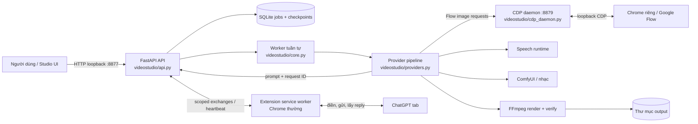
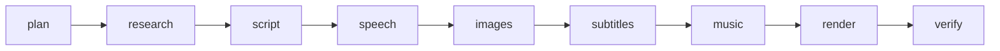

# VideoStudio

Ứng dụng local trên Windows để tạo và quản lý video theo dự án. Server và worker chạy trên máy người dùng; ảnh Flow dùng Chrome riêng; ChatGPT text dùng extension trên Chrome thường; file xuất mặc định lưu ở `E:\Videos`.

## Cài trên máy Windows mới

1. Cài Git, Python 3.12 x64, Google Chrome và FFmpeg (`ffmpeg`, `ffprobe` phải có trong `PATH`). Runtime/model/cache giọng đọc và ComfyUI là phần cài riêng; requirements không tự tải model lớn.

```powershell
git clone https://github.com/trinhmanhviet/videostudio.git D:\Projects\videostudio
Set-Location D:\Projects\videostudio
py -3.12 -m venv .venv
.\.venv\Scripts\Activate.ps1
python -m pip install --upgrade pip
python -m pip install -r requirements.txt
```

Nếu chưa có `py -3.12`, cài Python 3.12 trước. Launcher dùng `C:\Python312\python.exe` nếu có, nếu không dùng Python đầu tiên trong `PATH`.

2. Nạp extension: Chrome thường → `chrome://extensions` → bật Developer mode → **Load unpacked** → chọn `D:\Projects\videostudio\extensions\videostudio-chatgpt`.
3. Đăng nhập Google qua `Chrome - Clean.cmd`; sau đó mở **Mở debug** trong float để Flow cho phép tool điều khiển.
4. Bấm đúp **Start VideoStudio.cmd**. Mở Studio, đăng nhập ChatGPT trong Chrome thường. Trong float bấm **Start**, rồi **Test chữ** nếu bridge chưa kết nối.

Muốn tự mở Chrome riêng: dùng **Chrome - Clean.cmd** để đăng nhập bình thường; **Chrome - Debug.cmd** để điều khiển Flow; **Chrome - Stop.cmd** để tắt Chrome riêng. Cả ba cùng dùng `data/chrome-profile`, giữ tài khoản và dữ liệu. Chế độ sạch để đăng nhập; debug để điều khiển. Không đổi chế độ khi video hoặc tác vụ ảnh đang chạy.

ComfyUI nếu đã chạy được mở bởi shortcut của người dùng thì launcher sẽ dùng lại. Nếu chưa chạy, launcher gọi `scripts/start_comfy_recovery.py`, cần có cấu hình launcher/runtime hợp lệ trên máy đó. Launcher này không cài ComfyUI, model, node hay tài khoản. Khởi động backend thủ công:

```powershell
Set-Location D:\Projects\videostudio
python -m uvicorn videostudio.api:app --host 127.0.0.1 --port 8877
```

## Tạo và phục hồi video

- Float liệt kê từng video và trạng thái ChatGPT. Khi tab ChatGPT bị treo, chọn **Khôi phục ChatGPT** trên video. Tool tìm lại đúng phản hồi; nếu thiếu URL thì dán URL cuộc trò chuyện. Tool không gửi lại prompt khi khôi phục.
- Google Flow mặc định tạo **10 ảnh mỗi đợt**, mỗi prompt tạo x1. Tool gửi prompt, chờ ảnh của nhóm tạo xong, ghép theo ID cảnh rồi tải. Nếu 2K lỗi, nó đóng thông báo Flow và dùng 1K cùng ảnh. Sau một lần 2K lỗi, ảnh còn lại trong nhóm dùng 1K để tránh chờ timeout lặp lại.
- Đổi tài khoản Flow giữa video: float video → **Đổi tài khoản Flow** → **Chuẩn bị đổi tài khoản**. Chờ ảnh được đối chiếu và giữ lại; sau đó mở sạch, đăng nhập Google, bật debug rồi chọn **Tiếp tục video này**. Tool tiếp tục chính job đó và chỉ tạo cảnh còn thiếu. Luồng này giữ dữ liệu ảnh/checkpoint cũ và giữ nguyên biên nhận Flow.
- Nếu một lô bị lỗi, **Tiếp tục từ bước tạo ảnh** sẽ dùng lại các ảnh/biên nhận đã lưu. Đừng tạo video thứ hai để thay thế job đang phục hồi.
- Mười ảnh mỗi đợt đã có một lô Flow thực tế chạy xong. Hai mươi và ba mươi ảnh mỗi đợt vẫn khóa.

## Kiến trúc và luồng xử lý



Hai trình duyệt có vai trò riêng: extension bridge dùng Chrome thường để giao tiếp ChatGPT; Chrome riêng dùng profile riêng và CDP cho Flow. API và CDP daemon chỉ bind loopback. Không đổi chế độ Chrome riêng trong khi Flow đang tạo ảnh.

### Các bước của một job



Worker lấy job theo thứ tự; mỗi bước hoàn tất mới ghi checkpoint rồi chuyển tiếp. Retry/resume bắt đầu từ checkpoint thiếu hoặc bước người dùng chọn; asset đã được xác nhận giữ nguyên. Một worker và tài nguyên GPU dùng chung khiến **nhiều job chưa chạy đồng thời thật**; job mới được lưu và xếp hàng. Khả năng ChatGPT có nhiều session không đồng nghĩa với pipeline video song song.

### ChatGPT qua extension bridge

1. Người dùng bấm **Start** trong float để mở bridge; extension gửi heartbeat. **Test chữ** tạo smoke do người dùng chủ động để xác nhận round-trip.
2. Mỗi video có connector scope riêng dưới bridge gốc. API tạo exchange có request ID/version/prompt bất biến; extension chỉ nhận exchange thuộc bridge và scope mà server xác nhận.
3. Extension ghi prompt vào composer, gửi, đối chiếu user turn và reply theo request đang chờ, rồi trả receipt về API. Không ghép reply theo vị trí tab hoặc dùng câu trả lời của lượt cũ.
4. Trạng thái session được lưu để phục hồi sau reload. **Khôi phục ChatGPT** tìm đúng phản hồi bằng request marker/URL đã lưu; không tự gửi prompt lần nữa. Cần giữ tab Studio mở để float tiếp tục điều phối.

Các điểm vào chính: API/exchange tại `videostudio/api.py` và `videostudio/exchanges.py`; vòng đời job/checkpoint tại `videostudio/core.py`; extension service worker và giao diện float tại `extensions/videostudio-chatgpt/background.js` và `studio.js`.

### Flow, ảnh và đổi tài khoản

- Provider gửi prompt ảnh tới daemon loopback; daemon điều khiển tab Flow qua Chrome DevTools Protocol. Mỗi cảnh có task ID, job/run ID và checkpoint riêng để ánh xạ ảnh tải về đúng cảnh.
- Các prompt được gửi theo lô tối đa 10 ảnh đã xác nhận; chỉ tải/ghép khi kết quả lô được nhận diện. 2K không xác nhận hoặc bị Flow từ chối thì dùng chính ảnh 1K; không tạo ảnh thứ hai để thay thế mơ hồ.
- Khi đổi tài khoản, worker tạm dừng ở trạng thái chờ. Dịch vụ đối chiếu prompt và asset cũ, ghi checkpoint ảnh hợp lệ, rồi chỉ tạo các cảnh còn thiếu sau khi người dùng đăng nhập và tiếp tục. Nếu daemon không xác nhận đã yên, đổi profile bị chặn để tránh request cũ chạy nhầm trên account mới.

### Lưu trữ, khôi phục và hủy

| Dữ liệu | Vị trí mặc định | Dùng để |
| --- | --- | --- |
| Job, stage, exchange, checkpoint | `data/jobs.sqlite3` | Tiếp tục đúng job sau lỗi/restart |
| Profile Chrome riêng, receipts và cache runtime | `data/` | Giữ phiên Flow và liên kết task với asset |
| Ảnh, âm thanh, log và video theo job | `VS_OUTPUT_DIR` (`E:\Videos`) | Sản phẩm và dấu vết phục hồi |

`data/` không được đưa lên Git. Xóa job khỏi float có thể hỏi riêng có xóa output hay không; thao tác hủy job dừng công việc cục bộ của job đó, không hứa hủy tiến trình tạo đã được website nhận. Backup khi chuyển máy: sao chép output cần giữ; không chép profile Chrome đang mở. Database/profile không tự đồng bộ sang máy mới.

### Mã nguồn theo chức năng

| Thành phần | Tệp chính |
| --- | --- |
| HTTP API, preflight, job/project | `videostudio/api.py` |
| SQLite, checkpoint, hàng đợi và worker | `videostudio/core.py` |
| Điều phối provider, speech, ảnh, nhạc, render | `videostudio/providers.py` |
| Chrome/CDP và thao tác Flow | `videostudio/cdp_daemon.py`, `videostudio/cdp_flow.py`, `videostudio/chrome_browser.py` |
| Chuyển account Flow an toàn | `videostudio/flow_account.py` |
| ChatGPT bridge | `extensions/videostudio-chatgpt/` |
| Render, phụ đề, probe media | `videostudio/media.py` |

README mô tả luồng hiện hành; `docs/auto-pipeline-design.md` là bản đề xuất cũ, không dùng làm tài liệu kiến trúc hiện tại.

## File và cài đặt local

`data/` chứa database job, Chrome profile riêng, cache, Flow receipts và trạng thái runtime. Git ignore thư mục này. Video/ảnh đầu ra mặc định lưu ở `E:\Videos`; máy khác có thể đặt `VS_OUTPUT_DIR` trước khi khởi động.

Các biến môi trường thường dùng: `VS_DATABASE` (mặc định `data/jobs.sqlite3`), `VS_OUTPUT_DIR` (`E:\Videos`), `VS_CHROME_PROFILE` (`data/chrome-profile`), `VS_CHROME_EXE` (`C:\Program Files\Google\Chrome\Application\chrome.exe`), `VS_COMFY_URL` (`http://127.0.0.1:8188`) và `VS_LLM_TRANSPORT` (launcher đặt extension bridge). Mọi endpoint điều khiển chỉ nên dùng qua loopback.

## Mức nghiệm thu

Đã hoàn thành một video thật và lô thử Flow 10 ảnh. Chưa nghiệm thu mọi account, model, giọng đọc, thời lượng hay máy mới. Preflight có thể chặn job khi runtime/model cần thiết chưa sẵn sàng. Worker và GPU xử lý video tuần tự; **chạy nhiều video song song thật** vẫn còn trong [TODO.md](TODO.md).

Các hướng dẫn chi tiết: [bắt đầu sau khi restart máy](docs/startup.md), [tự khôi phục ChatGPT](docs/self-service-chatgpt-recovery.md), [chuyển tài khoản Flow](docs/flow-batch-verification.md) và [thiết lập Chrome riêng](docs/browser-profile-controls-2026-10-30.md).
