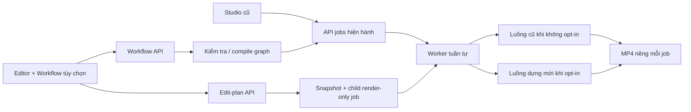
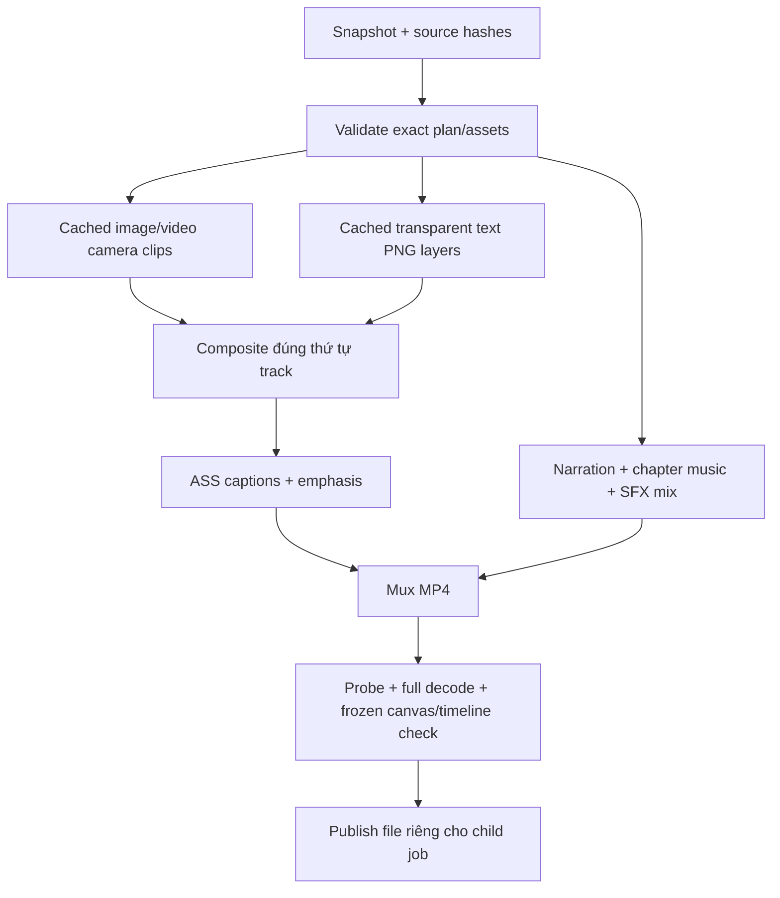
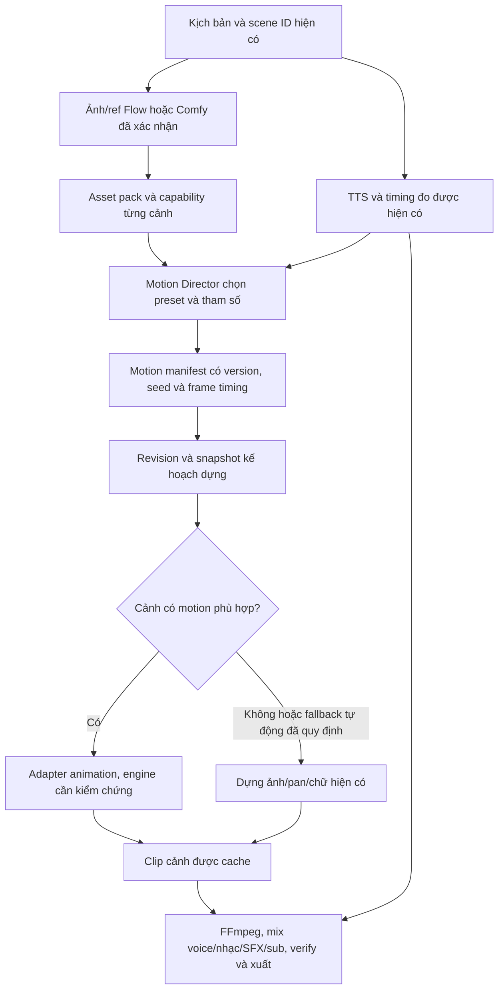

# Bàn dựng tùy chọn và Workflow canvas

Cập nhật: **2026-11-03**. Đây là tài liệu duy nhất cho phần bàn dựng mới/workflow: trạng thái, hướng dẫn dùng, thiết kế, schema, API, cơ chế render và kế hoạch nghiệm thu được cập nhật tại đây.

**UI cũ và luồng tạo video hiện hành được giữ nguyên.** Bản mới đã qua kiểm tra fixture/browser; nghiệm thu video AI dài và restart Windows vẫn do người dùng thực hiện riêng. Không tự chuyển request cũ sang bộ dựng/preset/nhạc mới.

## Mục lục

1. [Trạng thái, bằng chứng và việc còn lại](#status)
2. [Hướng dẫn dùng editor, preset, âm thanh và canvas](#guide)
3. [Kiến trúc, JSON schema, API, lưu trữ và cache](#architecture)
4. [Hợp đồng tích hợp và tiêu chí hoàn thành](#implementation)
5. [Kế hoạch thêm animation bằng asset và code — chưa triển khai](#code-animation)

README chỉ giữ cách khởi động và đường dẫn vào tài liệu; TODO giữ các việc chưa làm. Không tách thêm guide/architecture/status/spec/plan riêng cho tính năng này.


<a id="status"></a>
## Trạng thái, bằng chứng và nghiệm thu

### Trạng thái tổng thể

**Đã triển khai và nghiệm thu bằng dữ liệu tổng hợp**, gồm lưu kế hoạch, dựng MP4 thật và thao tác workflow trên trình duyệt. UI mới là lựa chọn thêm; Studio cũ vẫn là mặc định. Nhánh triển khai: `codex/editor-workflow`; checkout sử dụng hằng ngày: `D:\Projects\videostudio`.

Nghiệm thu video AI dài và restart Windows do người dùng thực hiện sau, theo thỏa thuận. Các phép thử dưới đây không thay thế hai nghiệm thu đó và không gọi provider AI thật.

### Đã có code

| Hạng mục | Hiện trạng |
|---|---|
| `edit_plan.json` | Schema/revision/sidecar, scoped assets, import và waveform, immutable child export |
| Ba preset | Documentary/Science/Everyday; áp dụng local, không thêm LLM |
| Nhạc chương | Nhóm theo speech/chapter, stable receipts, reuse, crossfade/normalization |
| SFX | Bốn sample procedural, source/license/hash, placement thưa, mixer |
| Renderer | Image/video layers, camera/crop/opacity/transition, transparent text theo stack, captions/emphasis, mux/verify/cache |
| Editor UI | Library, preview, inspector, multi-track timeline, drag/trim/split, chữ, undo/redo, save/export/status |
| Workflow | Typed graph, CRUD/history, compiler, canvas kéo/nối/config, templates/JSON/Run |
| Legacy compatibility | Opt-in mới; request cũ không tự bật renderer/music mới; UI cũ chỉ thêm entry tùy chọn |

Các thành phần được kiểm tra bằng schema/API/model tests, media tổng hợp thật và các thao tác trình duyệt ghi dưới đây.

### Bằng chứng đã quan sát

- Full Python: **619/619 đạt** (`python -m unittest discover -s tests -q`, 111,3 giây). Sau đó bổ sung assertion route Studio/editor/connector-test và chạy lại nhóm integration **5/5 đạt**; source backend không đổi sau lượt full.
- Full JavaScript: **139/139 đạt**, gồm toàn bộ test extension và `tests/*.test.mjs`, chạy lại sau sửa preview cuối.
- Renderer dùng MP4 thật, decode toàn bộ, so pixel thứ tự ảnh/chữ, motion/transition, thời gian, cache reuse và giữ hash nguồn.
- Nhạc/SFX dùng WAV thật để kiểm tra timing, fades/gain/mute, ducking, batching và stem reuse. Manual quiet mix không bị coi nhầm là model sinh âm thanh lỗi.
- Test cũ phụ thuộc voice inventory/batch receipt của máy chính đã được thay bằng fixture cục bộ, không sửa admission/voice production để chiều test.
- Log cục bộ: `data/final-python-tests.log`, `data/final-js-tests.log` (không đưa vào Git).

#### Nghiệm thu browser đã làm

Trên dữ liệu tổng hợp riêng tại localhost:8886:

1. Mở library, preview, inspector và timeline.
2. Chọn clip và đổi motion, lưu revision.
3. Thêm/sửa chữ `KHÁM PHÁ VŨ TRỤ`, xác nhận label trên timeline.
4. Undo/redo lấy đúng nội dung trước/sau.
5. Kéo clip và cắt mép, thấy timing đổi; lưu draft.
6. Bấm Xuất video từ UI → child job → worker fixture render/verify → **completed**; UI hiện link tải MP4.
7. Mở canvas, chọn node, cấu hình idea/duration/provider/voice và tắt nhạc; tham chiếu tự tắt khi chọn provider ảnh không hỗ trợ native ref.
8. Save graph thành revision 1, kéo node và lưu revision 2; ngắt/nối lại dây speech → captions.
9. Nhân bản, xuất JSON xuống file rồi nhập lại; UI xác nhận đã nhập/lưu workflow riêng.
10. Run tạo job thử `24c39776-dee2-4a69-88ec-9baeb0a65229`; đọc request xác nhận idea/duration 8 giây, voice fixture, Comfy batch 1, refs=false, music=false, sfx=true và graph có tọa độ node mới.
11. Bản xuất cuối `3b2efde8-5176-4c5d-8097-333bda0f4c8c` đã qua Worker render/verify → completed bằng renderer cuối; UI hiện link tải MP4.
12. Responsive desktop 1440×900 và khung hẹp đã được kiểm tra; viewport thử đã trả về mặc định.

Workflow Run đi qua API admission hiện hành; fixture chỉ giả preflight và không chạy model. Route mặc định, route workspace tùy chọn và connector-test có kiểm tra integration riêng.

#### Lỗi đã tìm và sửa trong quá trình thử

- Slider set value trước min/max/step làm tròn sai: đã sửa thứ tự khởi tạo.
- Select bị ép qua Number tạo NaN: giữ string cho enum.
- Text nhập chưa vào model trước save/undo: đồng bộ input và giữ focus khi redraw.
- Save response cũ ghi đè phần vừa gõ: giữ newer draft, tăng revision server đúng.
- Pointer-up bỏ sample cuối: áp tọa độ cuối khi kéo/cắt.
- Registry đọc `speech.scenes.path` không tồn tại: chấp nhận metadata scene không có file path.
- Mỗi lần stream một media lại rehash toàn bộ nguồn: chỉ kiểm tra asset được phục vụ; save/export/render vẫn kiểm tra đủ.
- Nhạc nhỏ user chọn bị hiểu nhầm là model sinh âm thanh lỗi: verify manual mix phân biệt chủ ý.
- Service không nhận executable FFmpeg/FFprobe cấu hình riêng: đã truyền từ pipeline.
- Preview dissolve tối/khác export: căn hold frame + entry alpha; video trim giữ frame cuối.
- Text luôn nằm trên mọi ảnh trong export: dùng PNG alpha thật và compose đúng track; pixel regression đạt.

### Phạm vi nghiệm thu và giới hạn

- Bàn dựng có thao tác thực trên media/timeline; các cửa sổ render dài được chia theo đoạn 30 giây, tối đa 24 decoder mỗi lượt compose. Preview chuẩn bị chỉ mục lớp khi nạp plan, giữ tối đa 32 ảnh cache không active, giải phóng audio/video đã ra khỏi đoạn đang phát.
- Preview thể hiện motion, crop, alpha, Z-order, subtitle và phát audio; đây là preview thời gian thực, không hứa khớp từng sample/font với FFmpeg. Âm lượng preview HTML audio giới hạn 100%; gain trên 100% vẫn được áp dụng đầy đủ khi xuất. Độ chính xác cue theo câu, không timing từng từ.
- Text dài được wrap trong vùng 86% chiều rộng bằng libass; renderer text cache đã đổi version để không dùng lại frame chữ cũ. Pan và caption scale có regression test.
- Cache media trên đĩa chưa có chính sách dọn tự động tổng quát. Không xóa asset được child export tham chiếu. Thư viện SFX có metadata nguồn; nếu đổi thuật toán sinh mẫu, cần version/migrate cache.
- Workflow hiện dùng các provider và thứ tự pipeline đã tích hợp; không phải trình chạy code/node tùy ý. Video song song thật, cài máy khác và nghiệm thu AI dài/reboot vẫn là công việc riêng trong TODO.
- Không cần reload extension cho bản editor này vì không thay source extension. Nạp backend chỉ khi `scripts/active_jobs.py` trả 0; F5 Studio để thấy entry tùy chọn.

### Server fixture và cách tiếp tục kiểm tra

Các script nằm ở `scripts/create_editor_fixture.py` và `scripts/editor_fixture_server.py`. Chúng khóa DB/output vào `data/editor-fixture` của checkout; không dùng E:\Videos hoặc DB production, không gọi Comfy/ChatGPT/Flow.

```powershell
& C:\Python312\python.exe -m scripts.editor_fixture_server --port 8886
```

Fixture hiện đã tạo:

```text
Source job: f5616ef4-d03f-4a15-88e3-edbeacde1629
Export browser completed: 3650e392-8b61-4085-b5c1-28f6d8d755aa
Editor: http://127.0.0.1:8886/editor.html?job=f5616ef4-d03f-4a15-88e3-edbeacde1629
```

`GET /fixture/info` xác nhận đây là fixture. `POST /fixture/advance-export` chỉ xử lý render-only child thuộc thư mục fixture; workflow job mới chỉ queued, không được biến thành lời gọi model thật trong test này.

Khi tiếp tục, kiểm tra process/endpoint hiện còn chạy trước khi thao tác. Không coi một log/lock cũ là chứng cứ tiến trình vẫn sống; cũng không restart chỉ vì một lần quan sát timeout.

### Yêu cầu không được bỏ quên

Người dùng đã nhấn mạnh: **đây chỉ là UI khác, UI cũ vẫn phải chạy mượt**. Không tự bật preset/nhạc chương cho form cũ, không đổi source/checkpoint job đang chạy, không yêu cầu duyệt bắt buộc và không đưa lại luồng retry LLM vô hạn. Canvas node đã được người dùng yêu cầu làm ngay; chuỗi nhiều LLM tự do và nhiều video chạy thật song song vẫn chưa thuộc nghiệm thu này.

<a id="guide"></a>
## Hướng dẫn sử dụng

### 1. Hai UI cùng tồn tại

- **Studio/UI cũ**: giữ form tạo video, lịch sử job, float ChatGPT/Chrome và editor ảnh từng cảnh hiện hành. Không bắt người dùng đổi cách làm.
- **Bàn dựng mới**: lựa chọn thêm để chỉnh media, lớp chữ, chuyển động, phụ đề, nhạc và SFX trên timeline.
- **Workflow canvas**: tab của UI mới, cho kéo/nối/cấu hình các bước và gửi yêu cầu tạo video vào pipeline thật.
- Không phải mọi job cũ được tự áp preset hoặc chuyển sang nhạc theo chương. Bộ dựng tự động mới chỉ bật khi request chủ động có `edit_preset`, `workflow` hoặc các tùy chọn node mới.
- Mở bàn dựng của video cũ tạo sidecar chỉnh sửa riêng; ảnh, WAV, nhạc, timing lời đọc và video đã xuất không bị ghi đè.

Trong Studio có **Bàn dựng mới (tùy chọn)** trên thẻ video/hero và **Workflow canvas (tùy chọn)** gần form tạo video. Nút **Xem / sửa ảnh từng cảnh** cũ vẫn giữ nguyên.

### 2. Mở bàn dựng

1. Mở Studio như hiện tại.
2. Chọn một video đã có lời đọc và ảnh.
3. Bấm **Bàn dựng mới (tùy chọn)**.
4. Trang mới có bốn khu vực: thư viện bên trái, preview giữa, thuộc tính bên phải và timeline bên dưới.

Đường dẫn trực tiếp khi backend mới đã được nạp:

```text
http://localhost:8877/editor.html?job=<job-id>
```

Để chạy workflow bằng extension ChatGPT, nên mở từ Studio đang kết nối. Liên kết này mang đúng connector scope và sử dụng route production hiện có:

```text
/story-video/projects/<scope>/production?workspace=editor&job=<job-id>&scope=<scope>
```

Không tự điền scope khác hoặc mở lại hàng loạt phiên ChatGPT. Phép ghép request/response và heartbeat của bridge vẫn do hệ thống cũ quản lý.

### 3. Thư viện media

- **Media**: ảnh/video/âm thanh đã tạo và media nhập thêm, lọc theo loại hoặc tìm theo tên.
- **Chữ**: các mẫu tiêu đề, nhãn thông tin và mốc thời gian; nội dung sửa ở Thuộc tính.
- **Âm thanh**: các stem lời đọc/nhạc đang có.
- **SFX**: whoosh, impact, chime, click tạo cục bộ.
- **Phong cách**: Documentary, Science, Everyday.
- **Phụ đề**: kiểu chữ, màu, vị trí và nhấn cụm từ theo cue thật.

Bấm **＋** để nhập media. Bản hiện tại nhận:

| Loại | Định dạng |
|---|---|
| Ảnh | PNG, JPG/JPEG, WebP một khung |
| Video | MP4, MOV, WebM, MKV |
| Âm thanh | WAV, MP3, M4A, OGG, FLAC, AAC |

Giới hạn API là 150 MB/tệp. Ảnh/video bị giới hạn kích thước; ảnh nhập được giải mã, áp EXIF orientation và lưu PNG. Video/âm thanh được probe và giải mã kiểm tra. Tên người dùng không trở thành đường dẫn chạy lệnh; server đặt ID/tên lưu riêng.

Bấm một media để thêm vào timeline hoặc kéo vào lớp phù hợp. Ảnh/video thêm qua thư viện ưu tiên lớp hình trống hoặc tạo lớp mới, giữ các cảnh nguồn. Đổi kích thước, vị trí và crop trong Thuộc tính. Không phát sinh lượt tạo ảnh AI khi thao tác media đã có.

### 4. Timeline và preview

#### Thao tác cơ bản

- Bấm clip để chọn và xem thuộc tính.
- Kéo thân clip để đổi thời gian; kéo mép để cắt.
- Bấm/kéo trên thước để tua; dùng nút phát/dừng và tốc độ preview.
- **Bắt dính** hỗ trợ đặt cạnh clip/con trỏ gần các mốc có sẵn.
- Thanh zoom, **Vừa video**, nút **＋ Lớp**, tách/nhân bản/xóa hỗ trợ bố trí bản dựng.
- Clip chồng thời gian được xếp thành các hàng con để đọc được, không che lẫn tên.
- Bấm tên lớp để đổi tên, khóa, mute/ẩn, đổi thứ tự lớp hình/chữ hoặc bỏ lớp khỏi bản dựng.
- Bỏ clip/lớp chỉ bỏ tham chiếu trong kế hoạch dựng; tệp nguồn vẫn giữ lại.

Thứ tự lớp hình/chữ trong timeline tương ứng thứ tự che phủ khi xuất. Phụ đề là lớp tổng hợp trên cùng; timing lấy từ lời đọc đã đo. Nếu tự đổi thời gian clip lời đọc, cần kiểm tra lại sự khớp với phụ đề; không tự sinh lại lời đọc để sửa việc này.

#### Thuộc tính clip

| Nhóm | Điều khiển |
|---|---|
| Thời gian | Bắt đầu, kết thúc, bật/tắt clip |
| Hình/video | Cover/contain, crop, vị trí, kích thước lớp, opacity |
| Chuyển động | Tĩnh, zoom vào/ra, pan trái/phải/lên/xuống |
| Chuyển cảnh | Cut, fade, dissolve, slide trái/phải |
| Chữ | Nội dung, cỡ chữ, màu chữ, nền nhãn, vị trí |
| Âm thanh | Gain, mute, source offset, fade in/out |
| Phụ đề | Bật/tắt, cỡ/màu chữ, màu nhấn, khoảng cách đáy, cụm từ nhấn |

Màu nhấn chỉ dùng cụm từ có nguyên văn trong cue, nằm trong khoảng thời gian cue đã đo. Không giả định có alignment từng từ. Margin mặc định là 576 px trên canvas 1080×1920, ở trên dải 30% phía dưới dùng bởi giao diện Shorts/Reels.

Crop mặc định của ảnh Flow tiếp tục bỏ khoảng 6% đáy; ảnh Comfy fallback hoặc ảnh nhập không tự bị áp crop Flow.

#### Phím tắt

| Phím | Tác dụng |
|---|---|
| Space | Phát/dừng preview |
| ← / → | Tua khoảng 0,1 giây |
| Shift + ← / → | Tua khoảng 1 giây |
| S | Tách clip đã chọn tại con trỏ |
| Delete / Backspace | Bỏ clip đã chọn |
| Ctrl+Z | Undo |
| Ctrl+Shift+Z hoặc Ctrl+Y | Redo |
| Ctrl+S | Lưu bản dựng |

Trong ô nhập văn bản, các phím gõ/undo văn bản được ưu tiên; Ctrl+S vẫn lưu kế hoạch dựng. Undo/redo của bàn dựng lưu trong phiên trình duyệt; lịch sử revision đã lưu còn ở phía server.

### 5. Lưu và xuất

**Lưu** ghi kế hoạch dựng, không gọi lại ChatGPT, Flow hay Comfy. Revision tăng sau khi server nhận bản hợp lệ. Nếu cửa sổ khác đã lưu trước, server trả conflict; không âm thầm ghi đè.

Khi save đang chạy mà bạn tiếp tục gõ, thay đổi mới được giữ ở draft; phản hồi save cũ không ghi đè nó. Trạng thái trên header cho biết còn thay đổi chưa lưu hay đã lưu revision nào.

**Xuất video**:

1. Lưu draft đang có.
2. Bấm Xuất video → Bắt đầu xuất.
3. Hệ thống tạo **child job chỉ render/verify**, đóng băng plan và hash media nguồn.
4. Dùng lại ảnh/lời đọc/nhạc; các clip visual không đổi được lấy từ cache.
5. Chờ trạng thái hoàn tất rồi tải MP4 mới.

Bản xuất cũ không bị ghi đè. Nhiều lần xuất có các job/file riêng trong cùng dự án. Mất phản hồi không được hiểu là chưa nhận job: UI giữ Idempotency-Key để đối chiếu, tránh tạo bản xuất thay thế ngoài ý muốn.

Bản xuất đóng băng là read-only trong UI mới. Chọn **Mở bản dựng gốc** để sửa draft rồi xuất tiếp; việc này giữ bằng chứng của bản đã phát hành.

### 6. Ba preset

| ID / tên UI | Hướng dựng |
|---|---|
| `documentary` / Documentary | Nhãn ấm, chuyển động chậm, zoom vào nhẹ, fade, điểm nhấn âm thanh thưa |
| `science` / Science | Màu lạnh, nhãn rõ, pan nhẹ, dissolve, chime |
| `everyday` / Everyday | Màu ấm, chữ dễ đọc, zoom ra nhẹ, fade, click/điểm nhấn nhẹ |

Preset dùng dữ liệu kịch bản/tiêu đề/chương có sẵn, không thêm lượt LLM để chấm điểm hoặc dựng lại liên tục. Chọn preset không tạo ảnh mới. Có thể tiếp tục chỉnh riêng từng clip. Khi áp preset, UI tạm khóa thao tác bản dựng trong thời gian lưu/áp dụng để tránh mất thay đổi.

### 7. Nhạc theo chương và SFX

- Luồng mới chủ động bật mới chia nhạc theo chương/phần có metadata và thời gian speech thật.
- Không có `chapter_index` thì dùng một phần nhạc, không suy ra một bài cho mỗi câu phụ đề.
- Mỗi phần nhạc có receipt ID ổn định, dùng lại khi retry, loop/crossfade đến độ dài phần và chuẩn hóa mức âm.
- Lời đọc được giữ rõ bằng ducking; chỉnh nhạc/SFX sẽ mix lại từ stems gốc, không dùng nhầm soundtrack đã trộn trước.
- Tắt node nhạc thì không gọi model nhạc. Checkpoint sẽ ghi rõ intentional mute, không giả đó là âm thanh do model sinh.
- SFX mặc định thưa ở tiêu đề/chuyển chương. Bốn sample là tổng hợp toán học cục bộ, có manifest nguồn, hash và CC0-1.0; không tải sample không rõ bản quyền.
- Có thể thêm, đổi thời gian, cắt, gain/mute/fade SFX trong timeline.

### 8. Workflow canvas

Canvas không thay UI cũ. Nó cấu hình các bước/provider đã có trong VideoStudio, không tự bổ sung mọi model có trong menu của công cụ tham khảo.

#### Kéo, nối và cấu hình

1. Mở tab Workflow.
2. Chọn template hoặc workflow đã lưu.
3. Kéo tiêu đề node để đổi bố cục; kéo nền để pan; cuộn để zoom; dùng Vừa khung khi cần.
4. Bấm cổng ra rồi cổng vào để nối. Bấm dây hoặc nút × trong kết nối vào để ngắt.
5. Chọn tiêu đề node để sửa cấu hình trong inspector.
6. Lưu, nhân bản hoặc nhập/xuất JSON.
7. Bấm Chạy workflow để gửi một yêu cầu tạo video thật qua cơ chế job/bridge hiện hành.

Các bước bắt buộc: input, script, speech, images, render, output. Các bước tùy chọn: research, references, captions, music, sfx.

| Node | Cấu hình chính |
|---|---|
| Input | Ý tưởng/lời có sẵn, thời lượng, chế độ |
| Research / Script | Text provider đang tích hợp; hai bước dùng cùng kết nối text |
| Speech | Giọng có trong thư viện, pitch |
| References | Bật/tắt tham chiếu nhân vật Flow |
| Images | Flow/ChatGPT/Comfy, batch Flow đã nghiệm thu, quality mode |
| Captions | Bật/tắt phụ đề đầu ra |
| Music | Bật/tắt nhạc, mức nhạc; luồng mới dùng phần/chương |
| SFX | Bật/tắt điểm nhấn cục bộ |
| Render | Preset |
| Output | Trạng thái và video kết quả |

Tắt/xóa nghiên cứu có nghĩa dùng lời đọc có sẵn; hãy nhập lời đọc hoàn chỉnh thay vì chỉ một chủ đề. Tham chiếu nhân vật native hiện yêu cầu Flow; chọn provider ảnh khác sẽ tắt node ref trong UI, và server chặn graph yêu cầu tính năng không được hỗ trợ. Flow fallback sang Comfy vẫn có cơ chế dùng lại ref đã tải của luồng Flow.

Graph phải có typed ports phù hợp, đủ input, không có chu trình hoặc node rời khỏi output. Bản này dùng các loại bước của pipeline hiện có và một node mỗi loại; không chạy code tùy ý hay một chuỗi nhiều LLM tự do. Các đường song song trên canvas không có nghĩa worker/GPU đang xử lý nhiều video đồng thời.

### 9. Gặp lỗi thì làm gì?

| Tình huống | Thao tác |
|---|---|
| Save báo stale/conflict | Giữ draft, kiểm tra cửa sổ khác; tải lại bản server rồi áp thay đổi cần thiết |
| Tệp nguồn đổi/mất | Không tạo lại cả video; kiểm tra nguồn/backup hoặc nhập media hợp lệ |
| Preview khác export | Giữ plan/revision và bản xuất để đối chiếu; bản này vẫn đang nghiệm thu |
| Export failed | Đọc lỗi và bấm tiếp tục xuất; không tạo lại ảnh/lời đọc/nhạc |
| Graph compile lỗi | Sửa node/port/provider được báo, không thử gửi job liên tục |
| Bridge scope/heartbeat thiếu | Về Studio, nối bridge đúng phiên; không tự giả heartbeat hoặc gửi lại prompt |
| Không thấy nút UI mới trên production | Mã tính năng có thể chưa được tích hợp/nạp; không tự restart khi job còn chạy |

<a id="architecture"></a>
## Kiến trúc và kỹ thuật

### 1. Biên tương thích



Không thay `STAGES` hiện hành: plan → research → script → speech → images → subtitles → music → render → verify. Compiler graph chỉ nhận cấu trúc có dependency mà pipeline này thực thi được. Những nhánh tắt có thể vẫn có checkpoint đánh dấu bỏ qua hoặc mute rõ ràng; chúng không được biến thành lời gọi model ngầm.

`editing_opted_in(job)` kiểm tra sự hiện diện của `edit_preset`, `workflow`, `references_enabled`, `captions_enabled`, `music_enabled`, `sfx_enabled`. Request từ form cũ không được tự thêm các trường này. Với opt-in, plan handler thêm `editing_version: 1`; speech scene của kịch bản nhiều chương giữ `chapter_index`.

Ở render:

1. Có `images.edit_plan_snapshot`: render chính xác snapshot, lỗi thì báo lỗi; không xuất kiểu khác thay thế.
2. Opt-in tự động: tạo snapshot default, render mới; lỗi metadata/hiệu ứng cục bộ có thể log warning rồi dùng renderer cũ. Không nuốt lệnh hủy.
3. Không opt-in: dùng render/music hiện hành.

### 2. Module và trách nhiệm

| File | Trách nhiệm |
|---|---|
| `static/editor.html`, `editor.css`, `editor.js` | Shell UI, library, inspector, timeline, save/export/status |
| `static/editor-model.mjs` | Edit bất biến, trim/split/move, stack order, packing hàng, undo/redo, timing preview |
| `static/editor-preview.mjs` | Canvas preview và phát audio theo plan; không sửa media |
| `static/workflow-canvas.js/.css` | Canvas node, dây, inspector, thư viện, JSON, Run |
| `videostudio/edit_plan.py` | Schema, asset registry, revision, sidecar, immutable export |
| `videostudio/edit_plan_api.py` | Same-origin API, upload giới hạn, media/waveform |
| `videostudio/editing_presets.py` | Ba preset local, không gọi model |
| `videostudio/edit_render.py` | Cache visual/text, composite theo stack, caption ASS, mux và verify |
| `videostudio/edit_audio.py` | Phần nhạc, SFX local, mix/duck/fade/stem cache |
| `videostudio/workflow.py` | Typed graph, validation, compile, CRUD và revisions |
| `videostudio/workflow_api.py` | API graph và compile |
| `videostudio/providers.py` | Điểm opt-in vào pipeline; giữ nhánh legacy |
| `videostudio/core.py`, `api.py` | Trường request mới, compilation tại admission, đăng ký routes |

Frontend là static ES modules; không cần npm build để phục vụ app. `static/package.json` chỉ khai báo module cho công cụ/test Node. Backend dùng dependencies hiện có: FastAPI, Pillow, FFmpeg/FFprobe và SQLite.

### 3. Plan schema v1

Ví dụ minh họa; `asset_id` phải lấy từ view của đúng job, không tự bịa ID/path:

```json
{
  "schema_version": 1,
  "job_id": "<job-uuid>",
  "revision": 0,
  "preset_id": "science",
  "duration": 8,
  "canvas": {"width": 1080, "height": 1920, "fps": 30},
  "tracks": [
    {"id":"visual","kind":"video","name":"Hình ảnh","muted":false,"visible":true,"locked":false},
    {"id":"labels","kind":"text","name":"Chữ","muted":false,"visible":true,"locked":false},
    {"id":"narration","kind":"narration","name":"Lời đọc","muted":false,"visible":true,"locked":false},
    {"id":"music","kind":"music","name":"Nhạc","muted":false,"visible":true,"locked":false},
    {"id":"sfx","kind":"sfx","name":"SFX","muted":false,"visible":true,"locked":false}
  ],
  "clips": [
    {"id":"visual-0000","track_id":"visual","kind":"image","scene_id":"scene-0000","asset_id":"<scoped-image-id>","start":0,"end":8,"source_start":0,"enabled":true,"fit":"cover","opacity":1,"motion":{"type":"zoom_in","amount":0.06},"transition":{"type":"fade","duration":0.3}},
    {"id":"title","track_id":"labels","kind":"text","text":"Một góc nhìn mới","start":0,"end":3,"enabled":true,"x":0.5,"y":0.18,"size":58,"color":"#FFFFFF","background":null},
    {"id":"narration-0000","track_id":"narration","kind":"audio","asset_id":"<scoped-speech-id>","start":0,"end":8,"source_start":0,"volume":1,"enabled":true}
  ],
  "captions":{"enabled":true,"font_size":52,"color":"#FFFFFF","accent_color":"#72D5FF","bottom_margin":576,"emphasis":[]},
  "narration":{"volume":1,"muted":false},
  "music":[{"id":"music-0000","track_id":"music","kind":"audio","asset_id":"music-section-0000","start":0,"end":8,"source_start":0,"volume":0.35,"fade_in":0.4,"fade_out":0.8,"enabled":true}],
  "sfx":[]
}
```

Các collection clip là `clips`, `music`, `sfx`. Narration clip nằm trong `clips`; không được giả định tất cả phần tử của `clips` đều là ảnh. Trường `plan.narration` là điều khiển gain/mute chung.

Các ràng buộc chính:

- ID ASCII chữ/số/`_`/`-`, tối đa 120 ký tự; không trùng giữa các collection.
- Thời gian hữu hạn, start ≥ 0, end > start và end ≤ duration.
- Canvas chẵn, mỗi cạnh 64–4096; fps 1–60. Plan duration 0,05–14.400 giây. Giới hạn admission job thông thường vẫn là 8–7200 giây.
- Asset phải có đúng kind, đúng registry của job. Video trim không vượt nguồn; audio có source offset và có thể dùng loop theo mixer.
- `x/y/opacity` 0–1; `width/height` lớp 0,01–1; crop normalized và không vượt khung nguồn.
- Motion amount 0–0,5; transition duration không vượt 5 giây hoặc độ dài clip. UI tự điều chỉnh hiệu ứng của clip quá ngắn khi trim/split/add.
- Color là hex sáu chữ số. Không nhận filter expression hoặc đường dẫn từ client.
- Emphasis có `utterance_index/start/end/text`, phải nằm trong cue speech thật và là nguyên văn trong narration cue đó.

### 4. Lưu, revision và snapshot

SQLite thêm các bảng:

| Bảng | Ý nghĩa |
|---|---|
| `edit_plan_heads` | Plan hiện hành và revision của mỗi job |
| `edit_plan_assets` | Asset nhập thuộc đúng job |
| `edit_plan_exports` | Child/parent/revision/hash snapshot |
| `workflows` | Graph hiện hành và revision |
| `workflow_revisions` | Lịch sử graph |

Plan lưu bằng optimistic concurrency: client gửi revision, server lấy write lock, kiểm tra head, validate, ghi revision mới và sidecar atomically. Stale trả 409. File JSON không thay thế cơ chế kiểm tra revision trong DB.

```text
<job-output>/
  edit_plan.json
  edit-plan-revisions/
    00000000.json
    00000001.json
  automatic-edit-plan-snapshot.json   # opt-in automatic defaults, nếu có
```

Export có `Idempotency-Key`; tạo job mới ở stage render, giữ các checkpoint nguồn, thêm `images.edit_plan_snapshot` và attestation hash của manifest. Snapshot chứa plan, parent job, resolved asset IDs/path/hash và cache directory riêng do server tạo.

```text
<child-output>/
  edit_plan.json
  edit-plan-snapshot.json
  brief.json
  ... các checkpoint nguồn tham chiếu lại media hợp lệ ...
```

Không cho client ghi resolved paths. Khi xuất/render, kiểm tra hash snapshot và toàn bộ media đã đóng băng. Xem media xác minh đúng asset được yêu cầu thay vì rehash tất cả nguồn mỗi thumbnail. Export và render vẫn kiểm tra đầy đủ, không nới lỏng vì tối ưu preview.

### 5. Bộ dựng FFmpeg



Visual cache key gồm source hash, canvas/fps, loại clip, source trim, fit/crop, motion, opacity/transition, kích thước và độ dài liên quan. Đổi placement/text/audio không mặc nhiên xin ảnh AI mới. Text raster có cache/hash riêng, alpha thật và được composite ở đúng vị trí track; không vẽ tất cả chữ lên trên mọi ảnh ở pass cuối.

Composite chia thành cửa sổ 30 giây, tối đa 24 input decoder mỗi pass để tránh giới hạn command line/decoder trên Windows. Dissolve giữ frame cuối clip trước trong khoảng entry fade của clip sau; preview được căn lại chính sách này, gồm giữ đúng frame cuối video đã trim. Fade/slide và opacity được áp vào layer, crop/zoom/pan ở camera clip.

Cache runtime nằm cạnh DB, gồm `editor-visual-cache`, `editor-audio-cache`, `editor-sfx`, `editor-thumbnails`, `editor-waveforms`, `editor-imports/<job-id>`. Đây là dữ liệu local, không đưa vào Git. Chưa có cơ chế dọn cache tự động tổng quát; không xóa cache/asset dùng chung tùy tiện khi child job còn phụ thuộc.

Service editor nhận đúng executable từ pipeline (`VS_FFMPEG`, `VS_FFPROBE`), không ép dùng PATH khi máy đã cấu hình đường dẫn riêng.

### 6. Audio và nhạc chương

`music_sections` nhóm các speech scene liên tiếp theo `chapter_index`, giữ timing đo được. Không có index thì một section. `generate_chapter_music` sử dụng receipt ổn định từng phần, summary `chapter-music.json`, normalization và covered-loop files; đoạn cuối giữ tail overlap để crossfade thực sự khớp metadata.

Checkpoint nhạc có path/duration/assets và danh sách sections với id, asset_id, chapter_index, start/end/section_end, duration, path/hash, source_start, volume, fades và provenance. Checkpoint nhạc cũ hợp lệ được dùng nguyên, không tái sinh để chạy editor.

Mixer lấy các clip audio từ plan, resolve asset ID, áp trim/delay/gain/mute/fades, dựng stem theo loại, duck nhạc dưới lời đọc rồi mux. Stem không đổi có thể tái dùng khi chỉ đổi nhạc/SFX/nhãn. Có batching để số input lớn không thành command line quá dài.

SFX `whoosh/impact/chime/click` là toán học cục bộ, manifest ghi `videostudio-procedural-synthesis-v1`, SHA-256 và CC0-1.0. Khi thay đổi generator ở bản sau, phải xem xét version/migration sample: không âm thầm thay bytes mà snapshot cũ đang tham chiếu.

Verify bản dựng thủ công kiểm tra stream, canvas/fps, thời lượng và decode toàn bộ. Gain nhỏ/mute do user chọn không bị gán nhầm là model sinh âm thanh lỗi. Automatic defaults vẫn có kiểm tra audio chất lượng tương ứng; không dùng đường manual để giả nghiệm thu model output.

### 7. Graph và admission

Graph schema v1: `id/name/revision/nodes/edges/viewport`. Node có `id/type/x/y/config`; edge có `id/source/source_port/target/target_port`. Validate duplicate IDs/type, typed ports, required inputs, cycle, rank và output contribution.

Compiler sinh request có graph chuẩn hóa, `edit_preset`, provider/voice/pitch/batch và các boolean `references_enabled/captions_enabled/music_enabled/sfx_enabled`. Native references yêu cầu image provider Flow. Hai node văn bản dùng cùng text provider đang tích hợp. Tắt research chuyển sang provided narration, bảo toàn lựa chọn lời đọc có sẵn.

Compilation nằm ở `POST /api/jobs` và compile API. `core.validate_request` chỉ validate graph, không compile đè scalar fields mỗi lần revalidate; đổi giọng/derivative giữ voice/pitch mới, không bị node speech cũ ép về giọng trước.

Những request không có graph hoặc field opt-in giữ contract cũ. Vẫn dùng exact connector scope, preflight/heartbeat/smoke và idempotency hiện hành. Giữ key cho request chưa rõ kết quả; không tự resubmit sau mất callback.

### 8. API

Các mutation giữ same-origin check. Tệp/thumbnail/waveform chỉ resolve asset thuộc registry job/snapshot.

| Method | Endpoint | Chức năng |
|---|---|---|
| GET | `/api/edit-presets` | Danh sách ba preset |
| GET | `/api/jobs/{id}/edit-plan` | View public, assets, capabilities, revision |
| PUT | `/api/jobs/{id}/edit-plan` | `{revision, plan}` |
| POST | `.../edit-plan/preset` | `{revision, preset_id}` |
| POST | `.../edit-plan/assets?name=...` | Raw upload giới hạn 150 MB |
| GET | `.../edit-plan/assets/{asset_id}` | Stream asset; `thumb=true` tùy chọn |
| GET | `.../edit-plan/waveform?asset_id=...` | Bins từ audio thật, cache theo hash |
| POST | `.../edit-plan/export` | `{revision}` + Idempotency-Key, child job |
| GET | `/api/workflows` | Saved graphs, templates, node types |
| POST | `/api/workflows` | `{graph, revision}` |
| GET | `/api/workflows/{id}` | Một graph |
| GET | `/api/workflows/{id}/revisions` | Lịch sử graph |
| DELETE | `/api/workflows/{id}` | Xóa workflow/lịch sử; không xóa video |
| POST | `/api/workflows/compile` | `{graph, request}` → request/graph/order |

HTTP quan trọng: 409 stale/conflict, 422 dữ liệu không hợp lệ, 413 upload quá lớn, 404 job/asset không có. UI không được đổi các lỗi này thành báo xuất thành công.

### 9. Kiểm thử và triển khai

Các nhóm test mới: edit-plan persistence/API, real FFmpeg renderer, audio/SFX, workflow graph/API/integration, opt-in compatibility, JS timeline model và save-race. Tests dùng nguồn tổng hợp; kết quả fixture không được dùng làm bằng chứng model/provider thật đã đạt.

Chạy toàn bộ trước khi release, với thư mục TEMP riêng trong checkout. Async/TestClient có thể cần quyền chạy loopback ngoài sandbox; không sửa production để chữa lỗi test socketpair.

```powershell
$env:TEMP = (Resolve-Path data/test-tmp).Path
$env:TMP = $env:TEMP
& C:\Python312\python.exe -m unittest discover -s tests -p 'test_*.py'

# Node test files của extension và tests/*.test.mjs, không chạy script E2E thật ngoài ý muốn.
```

Chỉ nạp backend khi đủ kiểm tra và không có job đang chạy. Không tự restart Windows; nghiệm thu reboot/video dài do người dùng thực hiện. Không đổi provider production sang nhánh FlowAPI HTTP thử nghiệm.

<a id="implementation"></a>
## Hợp đồng tích hợp và tiêu chí hoàn thành

### Phạm vi đã thống nhất

- Có edit_plan.json thực sự, giữ revision và ID cảnh ổn định; tái sử dụng ảnh/âm thanh hợp lệ khi chỉnh dựng.
- Có ba preset tài liệu, khoa học, đời sống; không thêm vòng LLM duyệt/chấm điểm hoặc bắt người dùng xác nhận từng bộ ref/hiệu ứng.
- Có nhạc theo chương/phần và SFX thưa, mix/fade/duck thực sự trong bản xuất.
- Có editor tối kiểu CapCut với thư viện, preview, inspector, timeline nhiều lớp và thao tác sửa thật.
- Có canvas kéo/nối/cấu hình/save/load/import/export/Run thật; không thay bằng sơ đồ tiến độ hoặc menu model chưa tích hợp.
- Mọi phần trên là UI tùy chọn. Không thay thế Studio cũ hoặc tự thay checkpoint/scene ID của job đã có.
- Video dài và restart máy thật do người dùng nghiệm thu riêng; không tự thực hiện reboot hoặc chạy video AI để đánh dấu hai việc này xong.

Tham khảo đã xem: video-tool.mp4 (55,89 giây) và FB_IMG_1793509205695.jpg, FB_IMG_1793509269896.jpg, FB_IMG_1793509278355.jpg. Các ảnh/clip chỉ là tham khảo bố cục/chức năng, không là bằng chứng mọi model/provider trong sản phẩm đó hoạt động ở VideoStudio.

### Chữ ký tích hợp

Các API nội bộ chính, cần đối chiếu code khi sửa:

```text
EditPlanService(store, ffmpeg='ffmpeg', ffprobe='ffprobe')
  view(jid)
  save(jid, revision, plan)
  preset(jid, revision, preset_id)
  import_asset(jid, raw, name)
  asset_file(jid, asset_id, thumbnail=False)
  waveform(jid, asset_id)
  export(jid, revision, key)
  automatic_snapshot(job)

register_edit_plan_routes(app, store, same_origin, public_job=None, *,
                          ffmpeg='ffmpeg', ffprobe='ffprobe')
render_edit_plan(job, check, ffmpeg='ffmpeg', ffprobe='ffprobe')
verify_edit_render(job, check, ffmpeg='ffmpeg', ffprobe='ffprobe')

music_sections(job, preset_id)
generate_chapter_music(pipeline, job, check)
ensure_sfx_library(folder)
default_sfx_events(scenes, chapters, preset_id)
mix_edit_audio(job, plan, resolved_assets, output, check, ffmpeg, ffprobe)

WorkflowService(store)
default_workflow(preset_id)
validate_workflow(graph)
compile_workflow(graph, base_request)
register_workflow_routes(app, store, same_origin)

mountWorkflowCanvas(container, {api, onRun, job})
  -> ready, getGraph(), isDirty(), setJob(), updateJob(), load(), destroy()
```

View edit-plan còn có utterances/chapters/capabilities và parent_job cho bản xuất đóng băng. Trả asset public bằng URL/ID, không trả private resolved paths ở view này. Endpoint export dùng định dạng public job hiện hành; không suy rộng quy tắc bỏ path của asset view thành tuyên bố mọi endpoint cũ đều đã bỏ path.

onRun nhận request đã compile; việc tạo job phải đi qua admission/connector scope thật. Không bypass owner tab, heartbeat, smoke, capability batch hoặc preflight. Không compile lại graph trong mỗi lần revalidate làm mất voice/pitch/preset vừa sửa của derivative.

### Trách nhiệm sửa code

- Nhóm plan/render: edit_plan.py, editing_presets.py, edit_render.py, edit_plan_api.py và tests tương ứng.
- Nhóm audio: edit_audio.py, procedural samples/metadata và tests.
- Nhóm graph: workflow.py, workflow_api.py, workflow-canvas.js/css và tests.
- Điểm tích hợp chung: core.py, api.py, providers.py, Studio navigation và editor.html/js/css. Phải thống nhất contract trước khi nhiều người cùng sửa các file này.

### Cách chốt công việc

1. Giữ kiểm tra regression của UI cũ và opt-in rõ ràng.
2. Test schema/API/race/revision/cache trước hoặc cùng sửa lỗi; không chỉ kiểm tra manifest có cờ xanh.
3. Render/giải mã MP4 và WAV tổng hợp thật, so pixel/thời gian/nguồn/hash; đổi chữ phải tái dùng clip hình không đổi, đổi motion phải invalid đúng clip.
4. Thao tác browser thật: kéo/cắt/select, inspector, preset, undo/redo, save/reload, playback, audio/SFX/crop/caption, workflow kéo/nối/config/save/compile/Run và tiến độ xuất.
5. Đối chiếu desktop và khung hẹp với tham khảo; không che điều khiển chính hay tạo overflow không dùng được.
6. Kiểm tra lỗi source/asset và request chưa rõ kết quả: giữ snapshot/receipt, không tạo thay thế hoặc giả trạng thái đã sẵn sàng.
7. Chạy full suite cuối, review, kiểm tra nguồn production không có xung đột và idle-job trước khi tích hợp/nạp backend.
8. Chỉ đánh dấu hoàn thành khi từng yêu cầu có bằng chứng thực tế. Module đã viết, lượt test thành phần hoặc screenshot đẹp chưa đủ.

Mọi cập nhật sau tiếp tục sửa tài liệu này và TODO, không tạo thêm một bộ handoff/status/plan trùng lặp.

<a id="code-animation"></a>
## Kế hoạch mở rộng: animation bằng asset và code

**Trạng thái: TODO, chưa triển khai.** Ghi nhận ngày 2026-11-03 từ đề xuất “Nâng cấp Story Video Pipeline sang Code-Driven Animation bằng HyperFrames”. Nội dung được điều chỉnh theo code hiện tại, không áp dụng nguyên văn các lệnh “implement”, “thay renderer chính” trong đề xuất. Việc tham khảo UI HyperFrames trước đây không có nghĩa VideoStudio đã dùng engine đó.

### Điểm giữ lại và điểm cần điều chỉnh

| Nội dung đề xuất | Áp dụng cho VideoStudio hiện tại |
|---|---|
| Thay chuỗi image → AI-video bằng code animation | Luồng đang dùng ảnh Flow/Comfy và FFmpeg, không có bước AI-video bắt buộc cần loại bỏ. Thêm khả năng animation nhiều lớp trên nền này. |
| Tạo scene planner/timeline/audio mới | Tái dùng scene ID, speech timing, `edit_plan.json`, asset registry, preset, chapter music, SFX, editor và workflow canvas. Không tạo pipeline song song cùng quản lý một timeline. |
| Comfy là nguồn asset duy nhất | Giữ cả Flow/Comfy và ref sẵn có; layer PNG alpha/mask/pose là capability bổ sung. Ảnh phẳng vẫn dùng được. |
| HyperFrames là renderer chính ngay | Chỉ là ứng viên engine cần kiểm chứng. Tích hợp qua adapter tùy chọn; FFmpeg tiếp tục mux/audio/verify và dựng các cảnh thường. |
| Word/phoneme timestamps đã có | Hiện dùng timing câu lời đọc đo được. Không suy ra thời gian từng từ/viseme chính xác từ timing câu. Alignment là khả năng bổ sung, không chặn video thường. |
| Ưu tiên 1920×1080, dọc để sau | Dọc 1080×1920 đang là mặc định của editor. Giữ mặc định đó và thử cả hai hướng ở demo mới. |
| Phải có đầy đủ rig/action/FX ở mọi cảnh | Phân loại theo asset thực có; thiếu bộ phận thì giảm motion hoặc dùng ảnh thường. Không ép thêm nhiều lượt AI cho mọi cảnh. |
| Tạo doc motion-engine riêng | Ghi thiết kế trong tài liệu này, tiến độ trong TODO; README chỉ dẫn vào đây. |

### Luồng tích hợp dự kiến



Đây là sơ đồ trách nhiệm, không phải thay thứ tự checkpoint đang chạy. Khi triển khai cần quyết định adapter nằm trong bước render hay có checkpoint con; không tự thêm stage top-level, đổi dependency của job cũ hoặc chuyển job đang chạy sang engine mới. Một video có thể dùng cả cảnh animation và cảnh ảnh thường.

### Hợp đồng dữ liệu và thư viện motion

- `edit_plan` vẫn là kế hoạch dựng tổng; asset pack/motion manifest là dữ liệu con có version và tham chiếu bằng scene ID/asset ID. Không lưu hai bản thời gian có thể lệch nhau; cue câu đã đo được quy đổi sang frame và giữ quy tắc làm tròn thống nhất. Schema v1 hiện kiểm tra field chặt, nên phải thiết kế version/migration trước khi mở rộng.
- Asset pack ghi nền, tiền cảnh, nhân vật, đạo cụ, mask, pose, mắt/miệng và metadata depth/pivot/anchor/bounds khi thực sự tồn tại. File đi qua registry hiện có, có hash; không chấp nhận đường dẫn tùy ý hoặc coi mask/alpha là có sẵn chỉ từ tên prompt. Capability phải kiểm tra cả nhóm asset cần cho một action.
- Motion Director dùng mô tả cảnh, mood, asset capability và audio timing để chọn từ thư viện đã cho phép: camera, parallax, micro motion, sprite/pose, prop/mask, FX và SFX events. LLM chỉ chọn preset/tham số, không sinh/chạy JavaScript tùy ý theo cảnh. Có đường chọn preset cục bộ khi không cần thêm lượt LLM.
- Mỗi primitive có schema tham số, version, giới hạn intensity và asset requirements; có thể phối hợp qua hierarchy/channel transform để blink, mouth, breathe, camera không ghi đè nhau. Random phải có seed; render lấy frame index làm đầu vào, không phụ thuộc đồng hồ realtime hoặc thứ tự seek.
- Cache/receipt bao gồm source hashes, manifest, preset/engine version, seed, fps, canvas và timing. Bản xuất đóng băng toàn bộ tham chiếu; đổi chữ/motion không sinh lại ảnh, giọng hoặc nhạc còn hợp lệ. Engine/primitive chưa cài hoặc khác version phải được phát hiện trước render.

### Tự động hóa và hạ cấp khi thiếu khả năng

Người dùng chọn kiểu video; tool tự kiểm tra và chọn motion phù hợp. Không yêu cầu user tự rig, tạo mask hoặc duyệt mọi scene trong luồng tự động. Asset nhập thủ công vẫn được hỗ trợ như lựa chọn nâng cao. Bắt đầu bằng một ảnh với camera/chữ; chỉ tạo/tách thêm layer có ích, trong ngân sách định trước và dùng lại ref đã xác nhận. Chưa mặc định rằng Comfy hiện đã có model/workflow tách bộ phận nhân vật.

Thứ tự hạ cấp dự kiến: motion đầy đủ → pose/layer đơn giản → camera/chữ trên ảnh phẳng → bộ dựng hiện hành. Mỗi trường hợp phải có giới hạn retry/timeout, trạng thái tiến độ, receipt và lý do fallback nhìn được trong UI. Không bỏ qua kiểm tra nguồn hoặc resubmit Flow khi kết quả cũ còn chưa rõ. Thiếu animation không được biến thành vòng lặp sinh lại asset/ref cho đến khi user can thiệp.

Nhánh tự động có thể hạ cấp theo chính sách đã ghi trong snapshot. Với export manual đã đóng băng, không âm thầm thay hiệu ứng user chọn: lỗi rõ ràng và cho user chọn bản xuất hạ cấp mới. Giữ checkpoint lời đọc/nhạc/ảnh và cho tiếp tục đúng phần còn thiếu. AI-video không phải đường cứu mặc định; chỉ xem xét sau, khi có provider khả dụng và user chủ động bật.

Lip sync đầu tiên có thể dùng closed/half/open theo năng lượng audio và khoảng ngắt, giới hạn tốc độ đổi miệng. Phải ghi là mouth animation theo audio, không tuyên bố khớp âm vị. Khi có alignment đáng tin mới bổ sung word/phoneme/viseme. Không có mouth/eye variants thì dùng head/camera motion, không chặn job. SFX gắn cùng event/frame của motion; mục tiêu sai số tối đa một frame cho event đã có timing, không áp đặt độ chính xác giả lên nội dung lời nói.

### Thứ tự thực hiện và tiêu chí nghiệm thu

1. **Engine spike:** kiểm tra package/phiên bản/license/API, deterministic seek, render headless, Windows, font và tài nguyên của ứng viên HyperFrames. Nếu không phù hợp, giữ contract và chọn adapter khác sau khi đánh giá; chưa thêm dependency vào production. Không cần áp đặt TypeScript/Zod lên backend Python và static ES modules hiện tại.
2. **Demo end-to-end:** asset thử cố định có một nhân vật blink/breathe/mouth, push/pan/parallax, đạo cụ + mask, particles/glint/flash, voice/SFX/sub; xuất MP4 30 fps cả dọc/ngang. Dùng synthetic assets trước để kiểm tra engine mà không tốn lượt AI. Seek lại frame cho cùng ảnh; không gọi AI-video.
3. **Tự động asset/Director:** thêm capability detection, asset preparation đã kiểm chứng và preset selection với ngân sách hữu hạn. Mở rộng camera/micro-motion trước; pose/action/impact/dash/weapon/FX phong phú làm dần sau khi đường cơ bản ổn.
4. **Editor/workflow:** thêm lựa chọn engine/style và inspector motion/capability trên UI sẵn có, không xây lại editor. Preview và export dùng chung manifest/primitive. Chỉ thêm node/port sau khi compiler/pipeline thật hỗ trợ; UI cũ giữ mặc định.
5. **Độ bền:** thử video hỗn hợp 30–100+ cảnh, cache reuse, bộ nhớ, hủy/resume, lỗi engine giữa chừng và fallback; chạy regression pipeline cũ. Runtime dùng tài nguyên theo cảnh/chunk, không giữ mọi asset full resolution hoặc mở browser mới cho từng layer.

Tiêu chí cuối là video tự chạy hết, giữ nguồn/checkpoint và không cần can thiệp khi chỉ thiếu motion tùy chọn. Có demo đẹp hoặc unit test không đủ để mặc định thay renderer cho mọi video. Các mục triển khai tương ứng vẫn để chưa hoàn thành trong TODO.
