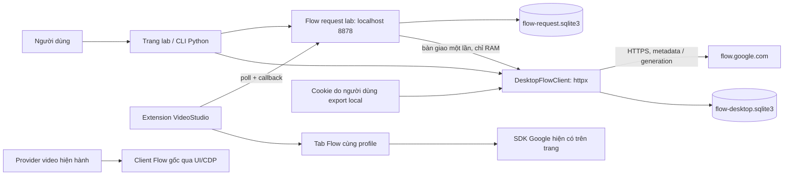
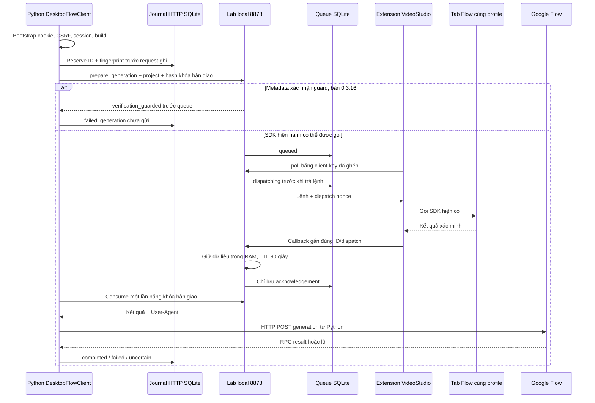
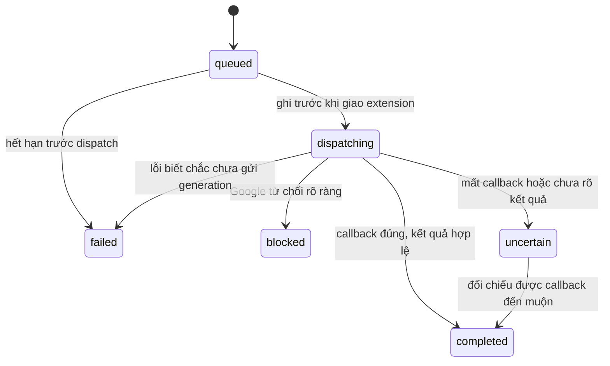

# G-Labs Studio tạo ảnh Flow như thế nào

Ngày 02/11/2026, múi giờ trình bày Asia/Saigon (UTC+7). Bản gốc được ghi nhận: [Claude Doc](https://claude.ai/artifact/QtBFFA5aFV1woqhYJNC48b). Bản này đã bổ sung mã nguồn, biên nhận và thử nghiệm thực tế của VideoStudio. Các tên project có chữ `UTC` được giữ nguyên như lúc tạo, không đổi sang giờ Việt Nam.

**Trạng thái cuối: chưa tạo được ảnh Flow bằng HTTP trực tiếp.** Python đã xác thực, đọc được project và tạo project mới; đã nối Chrome cùng tài khoản để bàn giao xác minh; request generation thật vẫn bị Google từ chối. Người dùng chọn **giữ Flow, chưa chuyển provider**. Provider Flow hiện hành của video vẫn dùng luồng UI/CDP.

## Tóm tắt

Phần mã Auth Helper đã đọc xác nhận G-Labs dùng extension làm bộ môi giới xác minh: nhận yêu cầu từ app local, gọi phần xác minh trong tab Flow và trả kết quả về app qua `127.0.0.1:18923`. Theo mô hình được mô tả trong tài liệu ban đầu, app desktop dùng cookie đã export để gửi generation. **Chưa bắt được request generation của chính app G-Labs và chưa có source phần gửi request của app**, nên không khẳng định endpoint, thư viện HTTP hay việc mọi generation của G-Labs đều diễn ra ngoài trình duyệt.

0.3.12 của VideoStudio thiếu giá trị xác minh trong hai context của generation. Đã sửa phần đó ở 0.3.13, nhưng vẫn thất bại. Sau đó đã xác nhận từ JavaScript do Google phục vụ rằng, khi cờ tính năng bật, SDK công khai bị thay thế bằng hàm đổi action thành `extension_hijack_detected`. **Token mới không đồng nghĩa token đúng action hoặc được generation chấp nhận.** Không còn dùng kết luận “payload đúng hoàn toàn, chỉ thiếu token mới”.

Nguồn chính: mã extension **G-Labs Studio - Auth Helper 9.0.19** (ID `clhcjdjbcldkogahjfmcgfipmlilmkpg`), tài nguyên cài đặt ở `D:\Tools-AI\G-Labs Studio`, HAR do người dùng cung cấp, mã VideoStudio và biên nhận SQLite/JSON. Lượt đọc G-Labs ban đầu không đọc storage/cookie và không chạy app G-Labs. Lượt thử HTTP VideoStudio sau đó **có dùng file cookie do người dùng cung cấp**, theo yêu cầu; không chép giá trị cookie/token vào tài liệu này.

## Các thành phần

Kiến trúc cần phân biệt app desktop, extension và tab website. Bảng dưới mô tả phần quan sát được; vai trò generation phía app vẫn có giới hạn bằng chứng như đã nêu.

| Thành phần | Chạy ở đâu | Vai trò |
| --- | --- | --- |
| App G-Labs Studio | `G-LabsStudio.exe`, có runtime Python 3.12/PySide6 và các thư viện đi kèm | Cung cấp cấu hình/yêu cầu và nhận kết quả xác minh qua cổng `18923`; đường gửi generation chưa được ghi nhận trực tiếp |
| Extension xuất cookie (cài riêng, không phải Auth Helper) | Chrome thường, người dùng tự bấm | Xuất cookie của tài khoản Google đang đăng nhập, người dùng dán vào app. App dùng cookie này để gửi request dưới danh nghĩa tài khoản đó |
| Extension Auth Helper | Service worker trong Chrome thường | Cứ 1,5 giây hỏi app một lần "có cần token không". Cần thì vào tab Flow lấy token rồi gửi về app |
| Script `content_interceptor.js` | Chạy trong trang Flow (MAIN world, từ `document_start`) | Chộp lại hàm `grecaptcha.enterprise.execute` gốc trước khi code của trang kịp bọc nó lại |
| Script `page_script.js` | Một đường thực thi trong trang Flow | Ưu tiên tham chiếu SDK lưu sớm, có fallback; trả kết quả có nonce qua `postMessage`. Worker cũng có đường thực thi hàm MAIN world trực tiếp |
| Script `content.js` | Trang Flow | Hiện nút nổi và lớp phủ "This tab is managed by G-Labs Studio", chặn click vào tab. Tự dừng mọi video trên trang để nhẹ máy |

**Quyền extension xin:** `cookies`, `tabs`, `scripting`, `webRequest`, `storage`, `alarms`, cùng quyền truy cập `*.google.com`, `grok.com`, `localhost`.

**Tên hàm/route không mô tả đúng nghiệp vụ.** `_syncFonts` là vòng trao đổi với app, `/sync/theme` nhận yêu cầu và `/sync/render` nộp kết quả xác minh; `_resolveWidget` điều phối việc gọi SDK. Có phép biến đổi XOR với hằng `0x5A`. Đây là làm rối dữ liệu, không phải bằng chứng về mã hóa bảo mật mạnh hoặc về mục đích của tác giả.

## Luồng một lần tạo ảnh

```mermaid
sequenceDiagram
  participant A as App G-Labs (G-LabsStudio.exe)
  participant E as Extension Auth Helper 9.0.19
  participant T as Tab Flow / SDK
  participant G as Google (reCAPTCHA + Flow)
  E->>A: 1. Hỏi app mỗi 1,5 giây (/sync/theme)
  A-->>E: 2. Cần token: request ID, site key, action
  E->>T: 3. Thực thi bước xác minh trong MAIN world
  T->>G: 4. Gọi tham chiếu SDK ưu tiên
  G-->>T: 5. Kết quả xác minh
  T-->>E: 6. postMessage(token)
  E->>A: 7. /sync/render: token + User-Agent (XOR 0x5A)
  A-)G: 8. Request tạo ảnh: cookie đã xuất + token (chưa xem được code)
  G--)A: 9. Kết quả generation, chưa đo trong lượt này
  Note over E,T: Có heuristic độ dài và retry trạng thái trang; không chứng minh token hợp lệ
```

Các bước nhận yêu cầu, gọi SDK và trả kết quả được đối chiếu từ extension. Bước app → Google trong sơ đồ là **phần được mô tả nhưng chưa kiểm chứng bằng source/request của app G-Labs**; nét đứt không được xem là nghiệm thu generation.

## Vì sao request tự dựng bị chặn

Google không chỉ kiểm tra cookie. Khi tạo ảnh, họ còn đòi bằng chứng rằng request đến từ một người đang dùng trang Flow thật.

- **Token reCAPTCHA Enterprise** (chuỗi `0cAFcWeA...`, khoảng 2.400 ký tự) nằm ở `context[10]` của payload `ogiZ0b`. Code reCAPTCHA trong trang sinh ra nó sau khi chấm điểm trình duyệt và hành vi người dùng. Token chỉ dùng được một lần và hết hạn nhanh.
- **Dùng lại token cũ không được.** Bản bàn giao đã thử bắt token thật rồi gửi lại, kết quả vẫn là `PUBLIC_ERROR_UNUSUAL_ACTIVITY`.
- **SDK công khai bị đổi action.** Đây đã được xác nhận từ bundle ứng dụng công khai của Google, không chỉ suy luận từ việc G-Labs lọc chuỗi `extension_hijack_detected`. Chi tiết ở phần chẩn đoán dưới đây.
- **Header `x-browser-validation`** có trong cả năm request generation thành công của HAR. Chưa xác minh nguồn sinh chính xác, tính bắt buộc hay quan hệ nhân quả với lỗi hiện tại. Không ghi rằng chỉ sao chép header này là sửa được lỗi.

Kết quả xác minh phải đúng ngữ cảnh/action và được Google chấp nhận, ngoài việc còn mới. G-Labs ưu tiên một tham chiếu hàm lưu sớm; VideoStudio hiện dùng API SDK công khai và không triển khai phần né lớp bảo vệ. Chưa có bằng chứng generation HTTP thành công từ cách hiện tại.

## So với VideoStudio

Bản 0.3.13 đã thêm lời gọi SDK công khai và hai trường xác minh. Nó **không tương đương toàn bộ cách G-Labs** vì không dùng tham chiếu hàm giữ trước lớp bảo vệ. Lượt thử lúc 03:47 UTC (10:47 giờ Việt Nam) vẫn bị `PUBLIC_ERROR_UNUSUAL_ACTIVITY`. Sau đó đã thử kiến trúc Python gửi HTTP thật ở cùng tài khoản, cũng bị từ chối.

| Cách làm | Ai gửi request tạo ảnh | Token lấy từ đâu | Kết quả đã biết |
| --- | --- | --- | --- |
| Provider CDP hiện tại (`cdp_flow.py`) | Chính trang Flow, khi tool bấm Generate | Trang tự sinh như người dùng bấm | Chạy được, đã xong một video thật và lô 10 ảnh |
| Bridge 0.3.12 | Extension `fetch()` trong tab Flow | Không có token mới | Bị chặn cả 3 lần (portrait, có ref, không ref) |
| Bridge 0.3.13 (chưa commit) | Extension `fetch()` trong tab Flow | Gọi `execute` sau khi trang đã tải xong, action `IMAGE_GENERATION` | Bị chặn 1/1 lần |
| 0.3.14 | Chẩn đoán chỉ đọc | Nhận diện dấu hiệu guard trên hàm SDK hiện hành | Có SDK, có site key, có guard |
| 0.3.15 + HTTP desktop | Python `httpx` gửi generation | Tab Chrome thường bàn giao kết quả SDK công khai một lần | Xác thực/tạo project thành công; generation bị chặn |
| Source 0.3.16 | Giữ HTTP desktop, thêm phát hiện/chặn sớm | Báo `verification_guarded` trước dispatch/SDK khi đã nhận diện guard | Đã kiểm tra chặn trước queue; không phải generation thành công |
| G-Labs | Đường gửi phía app chưa đo trực tiếp; chỉ thấy `curl_cffi` đi kèm | Ưu tiên tham chiếu hàm SDK được giữ sớm | Người dùng báo app chạy được; chưa nghiệm thu app G-Labs trong lượt nghiên cứu này |

Phân loại lại các giả thuyết ban đầu sau khi có bằng chứng mới:

1. SDK hiện hành có lớp đổi action: **đã xác nhận** trên tab và trong nguồn Google. G-Labs ưu tiên tham chiếu khác: **đã xác nhận từ mã extension**. Chưa thử sao chép cơ chế né lớp này.
2. Các điều kiện khác của generation — header, ngữ cảnh trình duyệt, phương thức gửi của app G-Labs — **chưa được loại trừ đầy đủ**. Không suy ra rằng bỏ guard là chắc chắn generation thành công.

## Rủi ro, điều chưa biết và lựa chọn

**Rủi ro của cách G-Labs**

- **Phụ thuộc vào bảo vệ của website.** Tham chiếu hàm được giữ sớm khác đường SDK công khai hiện hành. Thay đổi của Google có thể làm cách này hỏng; không có cam kết ổn định/API công khai cho cơ chế đó. Lượt nghiên cứu này không đo việc tài khoản bị đánh dấu hay bị cấm, nên không khẳng định hậu quả ấy đã xảy ra.
- **Quyền rất rộng.** Theo lệnh từ app, extension có thể xóa toàn bộ cookie của domain Flow, reload tab hoặc mở tab mới. Code bị đổi tên và mã hóa XOR nên khó kiểm tra.
- **Không kiểm tra được phần app.** App là file exe đóng. Chưa xem được nó làm gì với token và với tài khoản của bạn.
- **File cookie chứa thông tin xác thực nhạy cảm.** Phạm vi domain, hiệu lực phiên và các kiểm tra khác quyết định dịch vụ nào chấp nhận nó. Không khẳng định rằng chỉ có file là vào được mọi dịch vụ Google. Giá trị thật chỉ giữ trong file local bị loại khỏi Git; không đưa vào tài liệu, ảnh chụp minh họa hoặc báo cáo lỗi.

**Những điều chưa xác nhận**

- App có gọi đúng RPC `ogiZ0b` hay không. Trong `background.js` không có `ogiZ0b` hay `batchexecute`.
- `curl_cffi` (giả dấu vân tay kết nối TLS của Chrome) có phải là thứ app dùng để gửi request không. Mới chỉ thấy thư viện này có trong thư mục app.

**Lựa chọn cho VideoStudio**

| Hướng | Cần trình duyệt | Công sức | Ghi chú |
| --- | --- | --- | --- |
| Giữ provider CDP hiện tại, đưa cửa sổ Chrome riêng ra ngoài màn hình | Chrome riêng, không nhìn thấy | Nhỏ | Đang chạy được. Tránh click nhầm vì không còn cửa sổ để bấm vào |
| Extension điều khiển giao diện trong tab Flow, phủ một lớp chặn click như G-Labs | Tab Flow trong Chrome thường | Vừa | Trang tự gửi request với token thật. Không cần cổng debug |
| Dùng tham chiếu SDK lưu trước lớp bảo vệ như G-Labs | Tab Flow | Chưa nghiệm thu | Không triển khai trong VideoStudio; không có bằng chứng ổn định từ lượt thử này |

Ý đáng học từ G-Labs: lớp phủ chặn click trên tab Flow giải đúng nỗi lo click nhầm. Trang vẫn chạy bình thường bên dưới, còn người dùng không bấm trúng được gì.

**Quyết định của người dùng:** giữ Flow, chưa chuyển provider; muốn thử HTTP desktop thay vì coi UI là lời giải cho nhánh request. Bảng lựa chọn là bối cảnh, không phải bằng chứng các hướng đó đã được triển khai. VideoStudio không tích hợp phần né guard và không tự thêm provider/API tính phí khác.

## 1. Phân biệt ba thao tác thường bị gọi chung là “tạo nhân vật”

| Thao tác | Thực tế tạo gì | Bằng chứng cần có |
| --- | --- | --- |
| Tạo project | Mục dự án có ID/tên | RPC hoàn tất và mở được đúng project |
| Tạo Character | Mục nhân vật có ID/tên; có thể chưa có ảnh | RPC hoàn tất và đọc lại được Character |
| Sinh portrait/ảnh cảnh | Media ảnh thật, có media ID hoặc URL và dữ liệu ảnh | Generation được chấp nhận, có ảnh đúng yêu cầu và tải/giải mã được |

Tạo Character thành công **không có nghĩa** generation thành công. Trong lượt thử đầu, project và Character được tạo qua request. Request portrait thất bại. Sau đó agent nhập cùng prompt và bấm Generate gốc của Flow để làm đối chứng; chính lượt UI này tạo ra ảnh `Minh_Botanist` mà người dùng nhìn thấy. Không được gán ảnh đó cho request thất bại trước đó.

Đối chứng ấy cho biết tài khoản/client gốc có thể tạo ảnh tại thời điểm thử. Nó không biến transport HTTP của VideoStudio thành transport đã nghiệm thu.

## 2. Giao tiếp local quan sát được ở Auth Helper

| Thành phần/route | Vai trò quan sát được | Giới hạn kết luận |
| --- | --- | --- |
| `_readCanvasCfg()` → `/sync/config` | Nhận URL trang, cấu hình site key/script; có cache cấu hình | Chưa ghi nhận cấu hình runtime của một job G-Labs tạo ảnh thành công |
| `_syncFonts()` / `/sync/theme` | Vòng trao đổi với app, nhận công việc | Tên “font/theme” không phải nội dung nghiệp vụ |
| `_resolveWidget()` | Tìm/chờ tab, chọn cấu hình, điều phối lời gọi SDK và xử lý lỗi | Không tự gửi RPC `ogiZ0b` trong đoạn đã đọc |
| `page_script.js` | Lời gọi xác minh và trả kết quả có nonce về extension | Có đường ưu tiên tham chiếu lưu sớm, có đường fallback SDK hiện hành |
| `/sync/render` | Trả kết quả xác minh và User-Agent về app | Không phải endpoint Google tạo ảnh |
| `/sync/status` | Heartbeat/trạng thái local | Heartbeat không phải bằng chứng generation đã thành công |
| Các route `/sync/grok-*` | Chức năng khác của companion | Không dùng làm bằng chứng cho transport ảnh Flow |

`nonce`/request ID giúp nối yêu cầu với kết quả. Heuristic độ dài token chỉ là kiểm tra sơ bộ của companion. Một chuỗi đủ dài vẫn có thể sai action, sai ngữ cảnh, hết hạn hoặc bị Google từ chối.

Không tìm thấy chuỗi `ogiZ0b`/`batchexecute` trong `background.js` của companion. Điều đó chỉ cho biết đoạn mã này không chứa lời gọi ấy; **không chứng minh** app dùng REST khác, không chứng minh `curl_cffi` là sender và không chứng minh app không có nhánh UI/Playwright khác.

## 3. Kiến trúc thử nghiệm VideoStudio đã triển khai



Có hai đường thử độc lập:

1. **Trong tab:** extension chạy `fetch()` cùng origin với Flow. Cookie được trình duyệt gửi. Đây là các lượt 0.3.12/0.3.13.
2. **HTTP desktop:** Python gửi HTTP bằng file cookie local. Chrome chỉ thực hiện phần xác minh và bàn giao kết quả. Đây là lượt 0.3.15 + `DesktopFlowClient`; không bấm Generate để thay thế lượt HTTP.

Cả hai dùng cùng codec request/response. Không tự chọn nhánh này cho job video production. Endpoint trạng thái lab có `experimental:true`, `production_enabled:false`.

### Bản đồ mã nguồn

Đường dẫn trong bảng tính từ thư mục gốc repository.

| File | Trách nhiệm |
| --- | --- |
| [FlowAPI/protocol.py](../FlowAPI/protocol.py) | `build_command()`, chuẩn hóa ID/seed/ref, schema RPC, kiểm tra lỗi và giải mã kết quả |
| [FlowAPI/desktop.py](../FlowAPI/desktop.py) | Nạp cookie local, lấy bootstrap mới, HTTP trực tiếp, journal trước request ghi |
| [FlowAPI/bridge.py](../FlowAPI/bridge.py) | Ghép extension, hàng đợi bền, dispatch một lần, nhận callback, bàn giao xác minh trong RAM |
| [FlowAPI/server.py](../FlowAPI/server.py) | Router lab/API local và kiểm tra Host/Origin |
| [FlowAPI/client.py](../FlowAPI/client.py) | App/CLI nói chuyện với lab; đợi receipt và nhận bàn giao một lần |
| [flow/session.js](../extensions/videostudio-chatgpt/flow/session.js) | Quan sát metadata session của request trang; không xuất cookie Google |
| [flow/page.mjs](../extensions/videostudio-chatgpt/flow/page.mjs) | Kiểm tra đúng project, gọi SDK hiện hành, RPC trong tab, journal trang, phát hiện guard |
| [flow/background.mjs](../extensions/videostudio-chatgpt/flow/background.mjs) | Poll/dispatch/callback, phục hồi sau service worker bị ngắt, tránh lưu giá trị xác minh vào storage |
| [flow/popup.html](../extensions/videostudio-chatgpt/flow/popup.html) | Chọn server/tab, nhập mã ghép nối, kết nối/kiểm tra/ngừng nhận lệnh |
| [scripts/probe_flow_desktop.py](../scripts/probe_flow_desktop.py) | Probe HTTP chỉ đọc; không tạo media |
| [scripts/accept_flow_request.py](../scripts/accept_flow_request.py) | Các stage thử đường request trong tab, có provenance riêng cho portrait UI đối chứng |
| [scripts/accept_flow_desktop.py](../scripts/accept_flow_desktop.py) | Các stage HTTP desktop; nối adapter xác minh và tải kết quả nếu được chấp nhận |
| [videostudio/cdp_flow.py](../videostudio/cdp_flow.py) | Provider Flow UI/CDP hiện hành; không phải client HTTP mới |

`flow_api.py`, `flow_browser.py`, `BAN_GIAO.md` trong `FlowAPI/` là các bản thử/bàn giao ban đầu. Không coi thuật toán tự tính `at` từ SAPISID, session/build cố định hay parser cũ trong đó là entry point đã hoàn thiện.

## 4. Xác thực HTTP desktop và bài học về profile

### Bootstrap đúng của client mới

1. Đọc JSON cookie do người dùng cung cấp ở `FlowAPI/cookie.txt`.
2. Giữ domain/path, bỏ mục hết hạn và domain ngoài Google/Flow. Không gộp mọi cookie cùng tên thành một dictionary làm mất scope.
3. Dùng HTTPS tới `flow.google.com`; giữ xác minh chứng chỉ, không tự đi theo redirect và không lấy proxy từ biến môi trường.
4. GET trang Flow để lấy `WIZ_global_data` mới.
5. Lấy `SNlM0e` làm CSRF `at`, `FdrFJe` làm `f.sid`, `cfb2h` làm build `bl`. Session ID có thể cần chuyển sang chuỗi trước khi đưa vào query.
6. Gửi RPC chỉ đọc, kiểm tra đúng project thuộc tài khoản trước khi generation.

Cookie có mặt trong file không đồng nghĩa phiên còn được Google chấp nhận. Tương tự, trang trả HTTP 200 không chứng minh đã đăng nhập: bootstrap có thể có build/session nhưng thiếu CSRF đăng nhập.

Không dùng lại `at`/`f.sid` của một HAR cũ như thể chúng luôn khớp với cookie mới. Không suy ra CSRF của Flow bằng cách tự băm SAPISID. User-Agent cũng không phải bằng chứng hai phần đang dùng cùng tài khoản.

### Những gì đã xảy ra trong lượt thử

- Lượt dùng cookie + session cũ trả HTTP 401.
- File export tiếp theo có 17 mục, thiếu SID/HSID; HTTP chưa nhận được CSRF đăng nhập. Không đủ bằng chứng để quy mọi lỗi xác thực chỉ cho hai tên cookie này.
- Sau khi bổ sung dữ liệu xác thực do người dùng cung cấp, probe HTTP thành công và đọc được **11 project**.
- Project thử cũ không có trong danh sách và RPC đọc trực tiếp cũng bị từ chối.
- Người dùng xác nhận cookie lấy từ **Chrome thường**, trong khi lượt thử cũ dùng **Chrome riêng**.
- Tạo project mới bằng HTTP trong tài khoản của file cookie. Chrome thường mở được đúng project/tên đó. Sau khi tạo, probe đọc **12 project** và `test_project_found:true`.

Hai con số 11/12 là snapshot của lượt thử này, không phải điều kiện cố định của code.

| Ngữ cảnh | Đối tượng đã xác minh | Cách dùng trong báo cáo |
| --- | --- | --- |
| A: Chrome riêng, lượt thử ban đầu | Project `bf624dbc-42a2-4aa6-94a8-4765058c9734`, Character `eb1486f4-20e7-4995-b65e-f771367c5585` | Request trong tab và portrait UI đối chứng |
| B: Chrome thường + cookie HTTP | Project `fcead1b4-c4e7-4dc1-b08c-105719b354ae` | HTTP desktop và bàn giao xác minh cùng profile |

Không lấy Character/ảnh của A để coi như ref hợp lệ của B. Kiểm tra bằng khả năng đọc/mở đúng project đáng tin hơn chỉ so sánh tên cửa sổ hoặc User-Agent.

## 5. Endpoint, RPC và các trường request đã đối chiếu

Đây là schema quan sát được ở build đã thử, **không phải hợp đồng API công khai ổn định của Google**.

```text
POST https://flow.google.com/_/AiSandboxAngularFrontend/data/batchexecute

Query:
  rpcids       = RPC cần gọi
  source-path  = route của project/Character
  bl           = build từ bootstrap mới
  f.sid        = session từ bootstrap mới
  hl           = ngôn ngữ
  _reqid       = ID request của transport
  rt           = c

Form URL encoded:
  at           = <CSRF đăng nhập của cùng phiên>
  f.req        = [[[rpc_id, json_string(payload), null, "generic"]]]
```

Header thường dùng của client HTTP: `Origin`, `Referer`, `X-Same-Domain: 1` và User-Agent phù hợp với profile. Form được thư viện HTTP mã hóa. Không thêm giá trị header xác minh trình duyệt tự đoán hoặc lấy lại từ một request đã dùng.

| Operation trong VideoStudio | RPC/loại | Ý nghĩa thực tế |
| --- | --- | --- |
| `list_projects` | `UpteDb` | Liệt kê project |
| `create_project` | `jHPbke` | Tạo project |
| `create_character` | `C4BZMd` | Tạo mục Character có tên/ID |
| `rename_character` | `rzMKMb` | Cập nhật tên entity; cần đọc lại nếu muốn xác nhận tên cuối |
| `generate_image` | `ogiZ0b` | Generation ảnh/portrait |
| `list_characters` trong prototype | `ngNC2` | Tên operation hiện chưa chính xác: payload đọc cấu trúc project, chưa phải API danh sách Character đã chuẩn hóa |
| `prepare_generation` | `__flow_verify__` | **Lệnh nội bộ VideoStudio**, không phải Google RPC và không tạo ảnh |

HAR còn có `Zzl0ze` liên quan media project và `as29s` liên quan media/URL. Không gán chúng thành API liệt kê Character hay cập nhật portrait nếu chưa đối chiếu response và luồng thật.

### Schema generation dùng trong codec

| Vị trí | Nội dung đã quan sát |
| --- | --- |
| `payload[1][0]` | Một generation request; lượt thử luôn x1 |
| `payload[1][0][3]` | Seed |
| `payload[1][0][4]` | Mode: `2` ảnh project/cảnh, `3` portrait Character trong các mẫu HAR |
| `payload[1][0][5]` | Model enum `BELUGA`; UI lúc thử hiển thị Nano Banana 2.1 |
| `payload[1][0][7]` | Context generation, gồm project ID và dữ liệu xác minh |
| `payload[1][0][8]` | Prompt parts; text và native Character reference là những cấu trúc riêng |
| `payload[1][0][10]` | Danh sách Character ID, dạng `[[id1], [id2]]` hoặc `null` |
| `payload[1][0][12:14]` | Các UUID client của request |
| `payload[2]` | Số ảnh, đặt `1` trong nghiệm thu |
| `payload[3]` | Context ngoài cùng |
| `payload[4]` | Batch metadata; portrait cần binding Character |

Hai vị trí xác minh trong request thành công của HAR là:

```text
payload[1][0][7][10] = [<verification>, 1]
payload[3][10]       = [<cùng verification>, 1]
```

Cả năm request thành công được ghi trong HAR đều có hai vị trí này và giá trị giống nhau trong cùng request. Không suy ra phải sinh hai token độc lập cho hai slot. Không tái sử dụng giá trị đó cho một generation khác.

Portrait trong HAR có batch metadata:

```text
[batch_uuid, null, [target_character_id, [0]]]
```

Đã sửa codec vì chỉ đặt mode 3 và source path Character là chưa đủ binding. Với ảnh cảnh có ref, phải có cả native reference atom trong prompt parts và danh sách ID; viết chuỗi `@ten` đơn thuần không tương đương một native reference đã nối đúng entity.

Seed và các UUID được tạo ổn định từ request ID bằng UUID5. **Đây là cơ chế giữ định danh của client**, không phải cam kết Google cung cấp exactly-once hay tự deduplicate mọi lần POST trùng.

## 6. Đọc response: HTTP 200 chưa phải thành công

Response `batchexecute` có tiền tố chống XSSI, các dòng độ dài và frame JSON. Codec mới:

1. Bỏ tiền tố XSSI.
2. Tìm đúng một frame `wrb.fr` có RPC ID khớp yêu cầu.
3. Kiểm tra trường lỗi của frame trước khi đọc payload.
4. Giải JSON payload rồi giải mã theo operation.

`PUBLIC_ERROR_UNUSUAL_ACTIVITY` xuất hiện trong frame lỗi dù HTTP có thể là 200. Không được biến nó thành danh sách ảnh rỗng rồi báo thành công. HTML đăng nhập, frame của RPC khác hoặc payload sai cấu trúc cũng không phải kết quả hợp lệ.

Các vị trí ảnh được đối chiếu trong HAR:

```text
RPC payload[0]                 -> danh sách media
media[0]                       -> media ID
media[6][0][7]                 -> prompt metadata
media[6][0][13]                -> URL ảnh
media[6][2][0], media[6][2][1] -> width, height
RPC payload[1]                 -> metadata generation khác
```

Parser cũ nhầm lớp bao ngoài và cấu trúc `media[6]`. Chạy lại nó trên năm response generation trong HAR đều trả 0 ảnh. Codec mới giải được năm kết quả ảnh với ID, URL và kích thước. Việc sửa parser **không chứng minh** request mới đã được Google chấp nhận.

## 7. Bàn giao xác minh Chrome → Python đã triển khai

Luồng dưới đây thuộc VideoStudio, không phải việc gọi server G-Labs `18923`.



### Ghép extension với app

- Mã ghép nối ngẫu nhiên có hiệu lực 5 phút, dùng một lần.
- App lưu hash mã/khóa; extension giữ client key trong storage của chính nó.
- Worker gọi local API với Bearer key và `X-Flow-Client`; server ràng buộc client với origin extension đã ghép.
- Route local kiểm tra Host/Origin loopback. Không mở CORS cho website bất kỳ điều khiển Flow.
- Quyền Flow/scripting của VideoStudio là tùy chọn. Tính năng nằm trong extension VideoStudio hiện có, không cần extension Flow thứ hai.
- VideoStudio không xin quyền `cookies` của Chrome cho nhánh này. Python dùng file người dùng chủ động cung cấp.

### Bàn giao một lần

- Python tạo khóa bàn giao ngẫu nhiên; command chỉ chứa SHA-256 của khóa.
- Callback phải khớp client ID, request ID và dispatch nonce.
- Kết quả xác minh giữ trong RAM server tối đa 90 giây; không ghi vào SQLite.
- Consumer phải có khóa đúng; đọc sai khóa không làm mất kết quả của chủ sở hữu.
- Đọc thành công lấy kết quả ra khỏi bộ nhớ, không đọc lần hai. Callback lặp không được khôi phục giá trị đã tiêu thụ.
- Trình duyệt giữ kết quả đang bàn giao trong bộ nhớ để có thể đối chiếu callback; storage bền chỉ chứa marker/acknowledgement đã bỏ giá trị nhạy cảm. Sau ack, bộ nhớ trang được dọn cho request đó.
- Restart service làm mất kết quả RAM. Phải báo lỗi/đối chiếu, không tự mint lại bằng cùng receipt đã hoàn tất.

Lệnh `prepare_generation` hoàn tất chỉ xác nhận **bàn giao dữ liệu**, chưa phải ảnh được Google chấp nhận. Chỉ response generation hợp lệ và ảnh thật mới được tính thành công.

## 8. Journal, timeout và tránh tạo trùng

Hai database phục vụ hai lớp khác nhau:

| Kho | Nội dung | Không lưu |
| --- | --- | --- |
| `data/flow-request.sqlite3` | Client đã ghép, command, fingerprint, trạng thái dispatch và kết quả an toàn | Cookie Google và dữ liệu xác minh dùng một lần |
| `data/flow-desktop.sqlite3` | ID/fingerprint và kết quả của request HTTP ghi | Cookie, CSRF và dữ liệu xác minh |
| JSON manifest nghiệm thu | ID project/Character/media, kết quả từng stage, nguồn UI/HTTP, hash file ảnh | Giá trị đăng nhập |

Trạng thái chính:



Journal HTTP dùng `submitting` trước khi gọi bộ xác minh/POST, rồi `completed`, `failed` hoặc `uncertain`. Cùng ID/nội dung đã hoàn tất trả cache; cùng ID nhưng nội dung khác bị từ chối; request chưa rõ kết quả không được POST lại sau restart.

Timeout của bản thử:

- Request đọc trong trang: 20 giây; generation trong trang: 90 giây.
- SDK ready tối đa 5 giây; lời gọi xác minh tối đa 20 giây.
- Kết quả bàn giao ở RAM: 90 giây.
- Queue chưa dispatch: hết hạn sau 300 giây.
- Callback dispatch bị thiếu: sau 180 giây đánh dấu chưa rõ, không đưa lại queue.
- CLI HTTP desktop chờ toàn bộ stage tối đa 150 giây.

Năm request generation thành công trong HAR mất khoảng 20,7–25,5 giây. Timeout 20 giây cho generation là sai với mẫu này; đã tách timeout đọc và tạo ảnh.

`failed` biết chắc chưa gửi khác `uncertain`. Chỉ sửa code rồi tạo một ID mới khi đã có bằng chứng lần cũ bị từ chối/chưa gửi; không đổi ID để che một lần gửi mất phản hồi. Các runner giữ lịch sử `receipt_history` khi tạo attempt mới có chủ đích.

## 9. Kết quả nghiệm thu và định danh để tiếp tục

Run chung: `cca23b60-4de2-48e1-bce1-377f16450b2e`. Các ID dưới đây là bằng chứng lịch sử, không hardcode vào production. Client ID/tab có thể đổi khi ghép lại hoặc đóng/mở Chrome.

### A. Request trong tab, Chrome riêng

| Stage | Request ID | Kết quả |
| --- | --- | --- |
| Project | `7292223f-afe7-550f-944b-df2608265deb` | Thành công: project `bf624dbc-42a2-4aa6-94a8-4765058c9734` |
| Character | `04f946eb-0194-5310-b978-dffafe3ed1d0` | Thành công: `eb1486f4-20e7-4995-b65e-f771367c5585`, `Minh_Botanist` |
| Portrait RPC | `e297eb51-4ab8-561e-b23c-5082bcfca636` | `PUBLIC_ERROR_UNUSUAL_ACTIVITY` |
| Ảnh có ref | `a4910cc5-6b23-5977-b740-e22bf40ecb90` | `PUBLIC_ERROR_UNUSUAL_ACTIVITY` |
| Ảnh không ref lần đầu | `29755e9a-1add-5887-b988-9872dfca6853` | `PUBLIC_ERROR_UNUSUAL_ACTIVITY` |
| Ảnh không ref sau bổ sung SDK | `b59e6491-993f-5ce2-b60b-031963ed9b1e` | Vẫn `PUBLIC_ERROR_UNUSUAL_ACTIVITY` |

Ảnh có ref được thử sau khi Character đã có portrait thật từ lượt **UI đối chứng**. Manifest ghi `verified_native_ui_portrait_control`; không ghi portrait RPC thành công.

Portrait UI đối chứng:

- Media ID từ hộp lưu ảnh: `5dd8443f-1563-49c0-94b7-b2d4074c71e1`.
- File: `data/flow-request-acceptance/cca23b60-4de2-48e1-bce1-377f16450b2e/portrait-ui-control.jpg`.
- JPEG giải mã/kiểm tra được, 1376 × 768.
- SHA-256: `9c730864da3333884e99d07e3badd1bc6d211ce2ed80c1ebf08bec1de65848e8`.

### B. Python HTTP desktop, Chrome thường

| Stage | Request ID | Kết quả |
| --- | --- | --- |
| Xác thực và đọc project | Probe chỉ đọc | Thành công sau cập nhật cookie; kiểm tra lại thấy đúng project |
| Tạo project | `2e455486-b9f8-5075-a4c3-ef70421dbd64` | Thành công: `fcead1b4-c4e7-4dc1-b08c-105719b354ae` |
| Generation không ref | `88f470d0-983f-5c13-91f1-840488053eb0` | HTTP được gửi từ Python; Google trả `PUBLIC_ERROR_UNUSUAL_ACTIVITY` |
| Chặn trước queue khi có guard | Probe local riêng | Xác nhận không dispatch SDK và không gửi generation |

Không có ảnh HTTP desktop thành công để tải. Không tạo Character/ref của B rồi ghi nhận thành công khi chưa có generation; cũng không dùng portrait A để thay bằng chứng của B.

### Artifact local

| Đường dẫn | Dữ liệu |
| --- | --- |
| `data/flow-request-acceptance/.../run.json` | Các stage trong tab, lịch sử attempt, provenance portrait UI |
| `data/flow-desktop-acceptance/.../run.json` | HTTP project/generation, chẩn đoán và lựa chọn giữ Flow |
| `data/flow-desktop-acceptance/guard-origin-probe.json` | HTTP 200 của nguồn, một marker trong bundle Google, kích thước 1.199.306 byte ở snapshot đã đọc |
| `data/flow-request.sqlite3` | Queue/receipt của extension lab |
| `data/flow-desktop.sqlite3` | Journal gửi HTTP desktop |

`...` trong hai dòng manifest là run ID nêu ở đầu mục. Các artifact này nằm ngoài source Git và có thể không tồn tại trên máy khác.

## 10. Chẩn đoán guard đã nâng từ giả thuyết thành bằng chứng

Quy trình quan sát đã làm, không thay đổi SDK:

1. Đọc biểu diễn của hàm SDK hiện hành và chỉ xuất boolean có marker hay không.
2. Xác nhận trên tab: SDK có, site key có, `verification_guard_detected:true`.
3. GET HTML Flow trực tiếp từ Python; lấy URL bundle ứng dụng công khai ở `www.gstatic.com`.
4. Đọc bundle bằng HTTP không mang cookie Google tới CDN. Bundle có marker và logic thay thế hàm, nên không phải chỉ do một extension tự thêm vào trang.
5. Đối chiếu source: khi cờ tính năng bật, public `execute` chuyển lời gọi tới SDK với action đã bị ghi đè thành `extension_hijack_detected`; client gốc giữ riêng lời gọi đã bind trước đó.

Do đó, việc truyền `IMAGE_GENERATION` vào public API không chứng minh token được tạo với action ấy. Cả độ dài, độ mới và việc SDK trả Promise thành công đều không đủ để nghiệm thu.

Các tên minify như `_.JN`/`tZa` chỉ là dấu tìm kiếm trong build đã đọc, không phải API ổn định. Record metadata hiện không lưu nguyên bundle hay snapshot mã Google đầy đủ; khi build thay đổi cần thu lại bằng chứng phù hợp, không giả định marker/cơ chế luôn giống nhau.

0.3.16 xử lý hai chỗ: phát hiện guard tại thời điểm chuẩn bị SDK và từ chối sớm ở queue khi metadata client đã báo guard. Lỗi trả về là `verification_guarded`, biết chắc generation chưa gửi. Lớp này nhằm báo đúng lỗi và tránh lặp request sai action; nó không làm generation HTTP thành công.

## 11. Cách tự kiểm tra và đọc lỗi

### Đọc metadata trước, không tạo ảnh

```powershell
Set-Location D:\Projects\videostudio
& C:\Python312\python.exe scripts\probe_flow_desktop.py --project-id fcead1b4-c4e7-4dc1-b08c-105719b354ae
Invoke-RestMethod http://localhost:8878/api/flow-request/status
```

Probe HTTP cần `ready:true` và `test_project_found:true` với project thuộc đúng tài khoản. Trạng thái lab cần nhìn riêng `client_id`, độ cũ heartbeat, `tab_open`, `session_ready`, `project_id`, version và các cờ SDK. `session_ready:true` chỉ xác nhận session cho transport, không phải ảnh được tạo được.

Nếu chưa mở lab, dùng `Start Flow Request.cmd`. Nó chạy dịch vụ riêng 8878; không cần restart backend video 8877 chỉ để đọc trạng thái thử nghiệm. Trình Python trên máy hiện tại là `C:\Python312\python.exe`; máy khác cần môi trường đã cài dependency của dự án.

### Runner để tiếp tục đúng dữ liệu thử

Các runner hỗ trợ từng stage và ID ổn định. Ví dụ đường HTTP desktop:

```powershell
& C:\Python312\python.exe scripts\accept_flow_desktop.py --run cca23b60-4de2-48e1-bce1-377f16450b2e --stage project
& C:\Python312\python.exe scripts\accept_flow_desktop.py --run cca23b60-4de2-48e1-bce1-377f16450b2e --stage without-reference --client-id '<CLIENT_ID_CUNG_PROFILE>'
```

Đây là entry point nghiên cứu, **không phải cách khắc phục guard**. Cùng ID đã có receipt sẽ trả cache/lỗi cũ, không gọi generation mới. Muốn kiểm tra cookie hiện tại phải dùng probe riêng, không lấy một receipt project cached làm bằng chứng cookie còn hiệu lực.

Không dùng `--attempt` chỉ để thử nóng liên tiếp. Khi có guard, mở lại tab, đổi UUID hay restart server không tự biến public SDK thành client gốc. Phải có thay đổi kỹ thuật hợp lệ/bằng chứng mới trước khi thử một generation khác.

| Mã/tình trạng | Ý nghĩa | Hành động phù hợp |
| --- | --- | --- |
| `fresh_cookie_required` / HTTP 401 | HTTP chưa có phiên đăng nhập dùng được | Kiểm tra export đúng profile và bootstrap mới; không suy ra chỉ từ tên cookie |
| `test_project_found:false` | Chưa chứng minh đúng project/tài khoản | Đối chiếu profile, thử quyền đọc đúng project; không lấy ref của tài khoản khác |
| `tab_open:false` / `session_ready:false` | Tab được ghép không còn sẵn sàng | Mở/chọn lại đúng tab trong popup; giữ receipt cũ |
| `wrong_project` | Tab không ở project của command | Chọn đúng project trước khi dispatch; generation chưa gửi |
| `verification_unavailable` | Thiếu SDK hoặc site key công khai chưa xác định được | Kiểm tra trang và metadata; chưa gửi generation |
| `verification_failed` | SDK timeout/từ chối/kết quả không đúng kiểu sơ bộ | Không tự gửi generation với placeholder |
| `verification_guarded` | Public SDK đổi action sang marker | Dừng nhánh hiện tại; không retry để che lỗi |
| `PUBLIC_ERROR_UNUSUAL_ACTIVITY` | Google từ chối generation | Không báo completed; lưu request ID và điều kiện đã thử |
| `desktop_delivery_uncertain` | Không biết POST ghi đã được xử lý hay chưa | Đối chiếu cùng ID; không gửi lại mù quáng |
| `verification_handoff_uncertain` | Không rõ callback/bàn giao xác minh | Đọc receipt; không đồng nhất với việc Google đang tạo ảnh |

## 12. Kiểm tra đã thực hiện và giới hạn nghiệm thu

- 20 bài Node của `tests/flow-request-page.test.mjs` đạt: gửi một lần, journal trang, guard, SDK lỗi, bàn giao RAM và không lưu giá trị xác minh khi callback thất bại.
- 20 bài Python của `tests/test_flow_request.py` và 7 bài của `tests/test_flow_desktop.py` đạt: codec, scope cookie, bootstrap, API, khóa bàn giao, single-use, callback lặp/restart, journal HTTP và chặn trước dispatch.
- Codec đọc được 16 response của sáu operation trong HAR ban đầu, gồm năm kết quả ảnh. Đây là kiểm tra giải mã dữ liệu có sẵn.
- Đã làm các probe Google thật và một generation HTTP desktop thật như bảng nghiệm thu. Generation **không được chấp nhận**.
- Không dùng số bài test xanh, heartbeat, quyền extension, HTTP 200 hoặc việc có token làm bằng chứng nhánh ảnh đã xong.

Lệnh kiểm tra source, không gửi Google:

```powershell
& C:\Python312\python.exe -m unittest discover -s tests -p test_flow_request.py
& C:\Python312\python.exe -m unittest discover -s tests -p test_flow_desktop.py
node --test tests/flow-request-page.test.mjs
```

Không cần chạy lại toàn bộ suite để đọc tài liệu. Sau thay đổi có liên quan mới chạy kiểm tra tương ứng. Nếu môi trường sandbox Windows làm TestClient treo, dùng môi trường kiểm thử đã cấu hình; không suy ra backend thật chết và restart video vì một test bị kẹt.

## 13. Trạng thái bàn giao cho lần làm tiếp

1. **Giữ Flow.** Không tự chuyển sang Gemini API hay provider trả phí khác; người dùng đã từ chối chuyển provider ở lượt này.
2. Provider video hiện hành vẫn là luồng Flow UI/CDP đã có. Nó không được tính là HTTP desktop chỉ vì app gọi endpoint local.
3. Nhánh thử có auth HTTP, codec, adapter và receipt; chưa có ảnh HTTP thành công. Không đánh dấu hoàn tất nhánh request.
4. Source manifest là 0.3.16. Version đang chạy trong từng profile phải đọc từ `/status`; không mặc định file source và runtime đã cùng version. Tab/client ID trong log là snapshot, không bảo đảm vẫn tồn tại.
5. Đã kiểm tra API lab chặn trước queue khi client báo guard. Tab Studio được refresh, khôi phục view Phóng xạ và xác nhận gate text/production hiện hành vẫn sẵn sàng sau thử nghiệm. Điều này không nghiệm thu ảnh HTTP.
6. Chưa có source/trace generation của app G-Labs, chưa kiểm chứng endpoint/thư viện gửi của app. Đây là thiếu bằng chứng, không điền bằng phỏng đoán.
7. Lần nghiên cứu tiếp cần một đường generation được Flow chấp nhận mà không tái tạo/né lớp bảo vệ. Các công cụ kết nối sẵn chỉ quảng bá tài nguyên trang, chưa cung cấp công cụ tạo ảnh Flow cho agent; không từ đó suy ra mọi API/đối tác của Flow đều không tồn tại.

Các nội dung deferred khác như nhiều video song song, cài máy mới, nâng editor và Comfy fallback không được coi là đã giải quyết trong lượt nghiên cứu này.

## 14. Dữ liệu nhạy cảm và liên kết đối chiếu

Không đưa vào tài liệu hoặc Git: giá trị SID/HSID/cookie khác, CSRF `at`, bearer/client key, token xác minh, file profile Chrome và HAR thô. Trong ví dụ chỉ dùng placeholder. Các đường đã loại khỏi Git gồm `FlowAPI/cookie*.txt`, `FlowAPI/*.har`, `FlowAPI/flow_profile/` và `data/`. Package discovery cũng loại `FlowAPI.flow_profile*`.

Thông tin được giữ để review: operation, request/project/Character/media ID, transport thực sự gửi, phiên/profile đã đối chiếu, mã lỗi, kích thước/hash ảnh và provenance UI/HTTP. Không gán file ảnh từ một transport khác vào kết quả HTTP.

Tài liệu nội bộ:

- [Hướng dẫn Flow request lab](../FlowAPI/README.md).
- [Nghiệm thu request trong tab và portrait đối chứng](../FlowAPI/acceptance-2026-11-02.md).
- [HTTP desktop: kết quả và nguồn guard](../FlowAPI/desktop-status-2026-11-02.md).
- [Ghi chép đối chiếu Auth Helper](../FlowAPI/g-labs-research.md).

Nguồn chính thức dùng để đối chiếu cách hoạt động thông thường:

- [Chrome extension network requests](https://developer.chrome.com/docs/extensions/develop/concepts/network-requests).
- [Chrome scripting API](https://developer.chrome.com/docs/extensions/reference/api/scripting).
- [Chrome service worker lifecycle](https://developer.chrome.com/docs/extensions/develop/concepts/service-workers/lifecycle).
- [Google reCAPTCHA JavaScript API](https://docs.cloud.google.com/recaptcha/docs/api-ref-checkbox-keys).
- [Google Flow Help](https://support.google.com/flow/answer/16353333?hl=en).

Tài liệu SDK reCAPTCHA mô tả API thông thường; nó không phải cam kết Google cho phép dùng public SDK để gọi generation của Flow ngoài client gốc.
