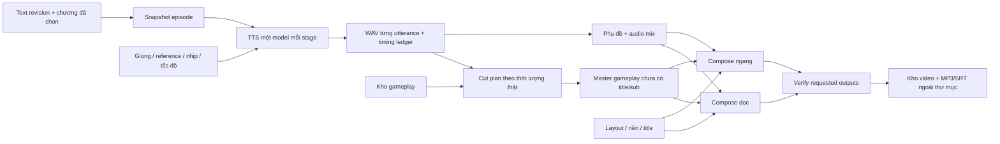

# Kể truyện bằng giọng đọc và gameplay — bàn giao Claude

Ngày 2026-11-14. Đây là đặc tả khả năng **chưa triển khai**, không phải mô tả chức năng đã chạy. Người dùng sẽ giao Claude thực hiện. Chỉ một tài liệu này và hai mockup, không tạo thêm bộ tài liệu thiết kế trùng lặp.

## 1. Mục tiêu và phạm vi đã chốt

Người dùng có kho truyện convert/dịch máy và **tự biên tập lại thành tiếng Việt dễ đọc**. VideoStudio cần một menu riêng **Kể truyện** để nhập truyện/chương, tạo lời đọc, ghép gameplay do người dùng quay, xuất video YouTube/Facebook và MP3/phụ đề đi kèm.

Ưu tiên: **giọng đọc hay, nhấn nhá tự nhiên, ngắt nghỉ đúng; chạy tự động ổn định; tự phục hồi; sau đó mới đến trang trí**. Không tự viết lại, tóm tắt hoặc cắt mất truyện. Không yêu cầu người dùng duyệt từng câu/chương để hàng đợi tiếp tục.

Nguồn hình v1 là **video gameplay của người dùng**, ví dụ game casual/puzzle. Gameplay làm filler, không cần khớp ngữ nghĩa từng câu truyện. **Ảnh sinh + motion tạm bỏ**, không xây trong đợt này. Không đổi renderer/pan/zoom của các chế độ video cũ. Không triển khai auto-post hay nền tảng sách nói riêng trong lượt này.

Mockup:

- [Màn Kể truyện](mockups/story-workspace-20261114.png)
- [Bố cục ngang và dọc](mockups/story-layouts-20261114.png)

Ảnh AI minh hoạ cách phân bổ element và nội dung. Khi ảnh có sai khác nhỏ về chữ, tỉ lệ khung hoặc số liệu minh hoạ, **hợp đồng kích thước và hành vi trong tài liệu này là chuẩn**. Không lấy pixel ảnh mockup thay cho aspect ratio chuẩn. Game minh hoạ trong ảnh không phải tài nguyên thật đã có sẵn.

## 2. Bối cảnh repo và ràng buộc

- Repo thật: `D:\Projects\videostudio`; source trong `app/`. Không sửa checkout cũ ở C, không đọc/chạy StoryForge.
- Backend `http://127.0.0.1:8877`, CDP daemon 8879, ComfyUI 8188. Story mode không cần ChatGPT/Flow/CDP/Comfy nếu chỉ dùng TTS offline + gameplay.
- Python backend là `C:\Python312\python.exe`, cwd source/test là `D:\Projects\videostudio\app`; không dùng Python miniconda mặc định để suy ra backend thiếu dependency. Node/FFmpeg hiện đã có, không tự nâng cấp.
- Python backend là `C:\Python312\python.exe`, cwd source/test là `D:\Projects\videostudio\app`; không dùng Python miniconda mặc định để suy ra backend thiếu dependency. Node/FFmpeg hiện đã có, không tự nâng cấp.
- Data theo `app/videostudio/paths.py`: `data/` bên cạnh `app/`; không hardcode ổ đĩa trong code mới khi đã có DATA_ROOT/RUNTIME_ROOT/Store.outputs.
- File thành phẩm hiện ở `E:\Videos\<project>\`, dữ liệu job ở `E:\Videos\<project>\data\<job_id>\`. Dùng cơ chế cấp phát/xuất/quyền sở hữu đang có, không nhận đường dẫn tuỳ ý từ request.
- Giữ nguyên các màn Tạo video, Hàng đợi, Kho video, Lịch đăng, Phòng thử giọng, editor ảnh/meme/workflow đang chạy. Không reintroduce mục Dự án riêng.
- Một theme UI: nền `#101827`, panel `#1b293c`, border `#35445b`, chữ `#f3f6fa`, chữ phụ `#a8b7c9`, điểm nhấn `#79c9ef`. Dùng font và nút chung của Tạo video/`studio-unified.css`. Ảnh nền trong video là tài nguyên nội dung, không phải theme UI mới.
- Giữ các giọng riêng **manhviet, Vương Bờm, Gấu hài hước** cùng reference/file/catalog hiện có.
- Không commit/push/reset/checkout/gỡ dependency. Không thay cài đặt hệ thống/bảo mật, không cập nhật môi trường VieNeu, không tải model mới/ASR.
- Chỉ restart dịch vụ khi guard tác vụ báo 0, tính cả job video/ảnh/đọc thử/clone. Không dừng job thật để lấy chỗ triển khai. Đừng tự mở/focus tab ChatGPT hoặc Flow.

## 3. Trải nghiệm người dùng và danh sách điều khiển

### 3.1. Menu và màn chính

Thêm **Kể truyện** cạnh Tạo video. Nằm trong shell đang có; Hàng đợi và Kho video dùng chung. Khi thêm menu phải xử lý responsive thực sự, không tiếp tục dùng số cột mobile hardcode gây lệch.

Màn chính ba cột theo mockup:

| Khu vực | Điều khiển/hành vi phải có |
|---|---|
| Thanh trên | Chọn truyện, Thêm truyện, thả/chọn TXT, chọn thư mục, trạng thái đã lưu/đang lưu/lỗi lưu. |
| Trái — Truyện & chương | Tìm chương; checkbox/chọn tất cả; thứ tự; tên chương; số từ/thời lượng ước tính; mở chương; kéo hoặc lên/xuống đổi thứ tự; menu đổi tên/xoá khỏi thư viện; phân trang. |
| Giữa — Nội dung | Tên chương; textarea đọc được thoải mái; số từ/ký tự/thời lượng; tự lưu + Lưu chương; checkbox Đọc tên chương; nút Đọc thử khoảng 1 phút; player, tua, tải MP3 mẫu. |
| Phải — Giọng kể | VieNeu/KhanhTTS; chọn giọng chung + nghe mẫu; nhịp tự nhiên/kể chuyện; tốc độ; 16/32 bước riêng Khanh; mẫu tham chiếu/transcript khi cần; link Phòng thử giọng; lưu thiết lập cho truyện. |
| Phải — Gameplay | Đủ tab/section quản lý clip, import video, thứ tự, tổng độ dài, đoạn bắt đầu/kết thúc hợp lệ; tiếng game mặc định tắt; không chỉ có thumbnail/nút giả. |
| Phải — Khung hình | Chọn nền, thông tin kênh/truyện/chương, xuất ngang/dọc, phụ đề, MP3/SRT đi kèm; mở preview bố cục. |
| Thanh cuối | Số chương đã chọn và tổng thời lượng ước tính; Mỗi chương một video/Gộp chương đã chọn; lưu nháp; thêm vào hàng đợi với số mục chính xác. |

Giữ bố cục và các nhóm nút; Claude có thể tinh chỉnh chi tiết implementation để hợp code hiện tại, không tự bỏ chức năng hoặc thay bằng placeholder. Trạng thái chưa đủ điều kiện phải nêu lý do, không khoá nút bí hiểm.

### 3.2. Nhập truyện và lưu nội dung

- Nhập một/nhiều `.txt`, kéo/thả file hoặc thư mục; chọn file/folder theo khả năng browser. Trên điện thoại vẫn chọn file được. Chưa cần DOCX/PDF/OCR/EPUB.
- Một file mặc định là một chương trong truyện đang chọn, không phải một truyện/dự án mới. Sắp xếp tự nhiên tên file: 1, 2, 10; cho sửa lại thứ tự.
- Tách tên truyện/chương thành metadata; không suy đoán rồi bỏ dòng đầu tuỳ tiện. Chỉ tách heading rõ ràng, giữ dữ liệu nguồn và quyền chọn đọc tên chương. Chưa rõ thì giữ toàn bộ body.
- Lưu UTF-8, giữ dấu câu, xuống đoạn, dấu thoại và nội dung người dùng đã sửa. Chuẩn hoá kỹ thuật được phép phải không làm mất từ hoặc đổi cốt truyện.
- Nội dung/chương/config lưu backend dùng chung instance, có revision và xung đột phiên bản rõ ràng; browser draft chỉ dự phòng phần đang sửa. Không nhét cả bộ truyện hàng ngàn chương vào localStorage.
- Import nhiều chương theo lô nhỏ/progress, không render tất cả textarea. Dedupe bằng nội dung + định danh chương; nhập lại file không tạo trùng mù quáng. Cùng tên mà nội dung khác phải là revision/cập nhật có thông báo.
- Xoá chương/truyện khỏi thư viện có xác nhận gọn, không xoá file nguồn người dùng hay thành phẩm đang được job khác dùng. Không làm thêm chuỗi popup dài.
- Ước tính dựa trên giọng/tốc độ; thời lượng xuất cuối cùng theo WAV thật. Không cắt truyện hoặc ép TTS chạy nhanh để khớp một số phút ước tính.

### 3.3. Chạy từng chương và gộp chương

- Mặc định mỗi chương được chọn là một mục hàng đợi/video, theo thứ tự hiển thị. Có lựa chọn gộp các chương đã chọn thành một episode; vẫn lưu mốc chương.
- Không ép toàn bộ sách vào một JSON/LLM response/request quá dài. Job đọc snapshot chương của server, chia utterance/lô có giới hạn, không bị mắc ở giới hạn idea 100.000 ký tự của mode cũ.
- Tạo snapshot bất biến của text revision + thứ tự + thiết lập + gameplay/library revision + layout khi enqueue. Sửa bản nháp sau đó không thay nội dung job đã nhận.
- Idempotency cho enqueue: mất response/bấm hai lần/F5 không tạo trùng. Mỗi mục có trạng thái và phục hồi riêng.

## 4. Giọng đọc — tiêu chí chính

### 4.1. Dùng đúng engine đang có

Dùng `app/videostudio/speech_engine.py`/`create_speech_job()`, không viết lại một SDK TTS khác và không cài thêm bản torch.

- VieNeu runtime: `data/runtime/media/.venv`; model cache `data/runtime/media/model-cache`.
- Khanh runtime: `data/runtime/khanhtts/.venv`; snapshot `kjanh/KhanhTTS-OmniVoice` revision `20d056b8ea5d8d578b4cbaf1f703012fa3798a84` đã tải, có codec. Không tải ASR.
- Tham số hiện có: `speech_engine`, `voice_id`, `speech_rhythm` natural/story, `speech_speed`, `khanh_steps` 16/32, `speech_batch_size`, `speech_reference_text` khi clone cần lời mẫu.
- 16/32 là số bước tinh chỉnh của Khanh, không phải số câu đồng thời. Hiện adapter Khanh chia lô nội bộ tối đa 8 để giới hạn VRAM. Giữ giới hạn đang có trong v1; không tự stress/tối ưu CUDA.
- Kế thừa thiết lập đã lưu cho truyện/giọng. Khi chưa có, dùng cấu hình đã được nghe thử: Thiện Minh, nhịp kể chuyện, 1,0×; engine theo lựa chọn đang dùng, không âm thầm đổi engine.

### 4.2. Phân biệt nghỉ và diễn cảm

Người dùng chấp nhận mẫu **nhịp B** nhưng chê `[cười]`, `[thở dài]`, `[hắng giọng]` giả tạo. **Không tự thêm các thẻ này**. VieNeu v3 Turbo bỏ qua `style`; Khanh hiện dùng giọng/reference, chưa có điều khiển cảm xúc tuỳ ý đã nghiệm thu. Không dựng dropdown buồn/giận/hồi hộp rồi truyền tham số vô tác dụng.

- Nhịp nghỉ là xử lý thực sự có tác dụng; sắc thái dựa trên mẫu giọng. Mô tả đúng giới hạn trên UI.
- Chia cụm đọc theo câu/đoạn/thoại tự nhiên, giữ ngữ cảnh đủ dài. Không đọc từng từ, không lấy giới hạn phụ đề làm giới hạn câu TTS, không cắt WAV giữa âm tiết.
- Khoảng nghỉ khác nhau theo dấu câu và ngắt đoạn; **đo im lặng đã có** rồi chỉ bù phần thiếu, không cộng lặp đuôi + đầu + pause của nhiều tầng. Không tăng nghỉ hàng loạt làm truyện lê thê.
- Không lạm dụng đổi pitch, gain hay random tốc độ để giả cảm xúc. Tốc độ 1,0× giữ tự nhiên; đổi tốc độ theo lựa chọn người dùng bằng cách bảo toàn chất giọng.
- Nạp model một lần cho episode/chapter stage, đọc theo lô và giữ WAV riêng từng utterance. Tiếp tục từ WAV còn thiếu/hỏng, không nạp lại model cho từng câu.
- Lưu utterance ID ổn định, spoken text, hash, sample rate, số mẫu, start/end và pause. Concat/timing/subtitle đều lấy cùng ledger.
- Reference clone phải có WAV đúng và transcript đúng. Preset có thể dùng cơ chế chuẩn bị reference cục bộ đã có. Preflight báo thiếu trước enqueue; không để job chờ vô hạn vì thiếu lời mẫu.
- Nếu dùng mẫu sắc thái từ Phòng thử giọng, resolve qua service có kiểm tra quyền/ID rồi đóng băng WAV/hash/transcript vào manifest nội bộ. **Không lộ token owner trong public job request**, không tự mở quyền sửa/xoá audio chéo browser; giữ hợp đồng truy cập hiện có.

### 4.3. Nghe thử và nghiệm thu chất giọng

- Đọc thử là tuỳ chọn riêng, dùng đoạn đang chọn hoặc phần đầu đủ khoảng 60–90 giây. Số giây là ước tính trước khi sinh, sau đó hiển thị thời lượng đo thật.
- Player có phát/tạm dừng/tua và tải MP3; có thể dùng lại API Phòng thử giọng thay vì tạo cơ chế mới.
- Không cần gameplay để nghe thử. Không chặn tự động toàn bộ sách để người dùng duyệt mỗi chương.
- Đọc đúng từ, nhấn nhá, câu hỏi/thoại và hơi thở phải do người dùng nghe duyệt; peak/RMS/HTTP 200 không chứng minh đọc hay. Chưa nghe thì không tuyên bố cải thiện cảm xúc.

## 5. Gameplay do người dùng cung cấp

- Nạp một/nhiều MP4/MKV/MOV/WebM mà FFmpeg hiện tại giải mã được; có thể thu hẹp định dạng UI nếu môi trường không hỗ trợ nhưng phải nêu rõ trước upload. Không tự mở game hay quay màn hình.
- Kéo/thả/chọn file; hiện thumbnail, tên, độ dài, kích thước/fps và tổng pool. Có thứ tự playlist, bỏ clip khỏi pool, điểm bắt đầu/kết thúc hợp lệ. Mặc định phát theo thứ tự; không cần AI hiểu nội dung gameplay.
- Upload lớn phải streaming/chunked có tiến độ; không base64 cả video vào JSON. Tính hash khi import, lưu đúng một bản nguồn dùng chung.
- Đề xuất nguồn gameplay dùng chung tại `DATA_ROOT/media-library/gameplay/`, có thể cấu hình; đây là thư viện, không nằm trong một job rồi bị dọn theo job. Giữ file người dùng chọn ban đầu nguyên vẹn.
- Nếu nguồn dài hơn lời đọc: lấy đủ khoảng cần. Nếu ngắn hơn: nối clip tiếp theo, hết pool thì lặp có kế hoạch rõ ràng. Không kéo tốc độ game để bù thời lượng, không kéo một frame tĩnh dài ở cuối.
- Giữ trọn khung gameplay bằng contain; không crop mất HUD hoặc kéo méo. Nguồn không phải 16:9 thì letterbox bằng cùng nền. Tắt audio game mặc định. Nếu cho bật lại, phải xử lý nguồn không có audio và ưu tiên lời kể; v1 không bắt buộc thêm nhạc/SFX/Comfy.
- Có tuỳ chọn tiếp tục vị trí gameplay ở chương sau. Lập cut plan sau khi biết độ dài WAV thật; lưu `source_id/sha/start/end/order` và cursor theo transaction/job ID để retry không tiêu thụ lại/vô tình nhảy clip.
- Preview bố cục/đọc thử không dịch chuyển cursor. Retry cùng snapshot giữ nguyên cut plan. Nếu chọn random về sau thì seed phải cố định, không random lại sau lỗi.
- File nguồn bị chuyển/xoá/thay nội dung: báo chính xác nguồn nào, cho relink có xác nhận/hash; không làm lại lời đọc đã đúng và không đứng im vô hạn.

## 6. Hợp đồng bố cục video

Xuất H.264/AAC MP4, yuv420p, SAR 1:1, **30fps**; mặc định bật cả hai định dạng. Khi chỉ chọn một định dạng chỉ cần render định dạng đó. Metadata output phải ghi rõ orientation; không gắn nhãn Dọc cho file chỉ-ngang.

Các toạ độ dưới đây là cấu hình khởi đầu bám phác thảo người dùng. Cho thay nền/thông tin và tinh chỉnh vùng bằng preset nếu cần, không bắt người dùng kéo căn từng chương.

### 6.1. Ngang 1920×1080

| Thành phần | Vùng ban đầu |
|---|---|
| Nền | Toàn canvas, màu/ảnh theme tĩnh từ kho hoặc người dùng nạp. |
| Tên kênh, tên truyện, chương | Phần trên, khoảng y=24–170, có margin trái/phải, title dài tự wrap/clamp hợp lý. |
| Gameplay ngang | **x=384, y=178, w=1152, h=648**, 16:9 nguyên khung (người dùng chỉnh nhỏ lại ngày 2026-11-14; bản đầu 1344×756). |
| Phụ đề tiếng Việt | Vùng nền dưới gameplay, khoảng y=862–975; tối đa hai dòng, font 46px + viền, nằm trong canvas. |

Gameplay là khung ở giữa với lề, không chiếm toàn màn. Phụ đề nằm ở nền dưới, không che game. Không mặc định dịch phụ đề sang tiếng Anh/đòi LLM; chuyện tiếng Việt đọc bằng tiếng Việt.

### 6.2. Dọc 1080×1920

| Thành phần | Vùng ban đầu |
|---|---|
| Nền | Toàn canvas, cùng theme bản ngang, kéo dài phần trên/dưới. |
| Tên kênh, tên truyện, chương | Vùng trên khoảng x=80, y=210, w=920, h=280; tự căn title dài. |
| Gameplay NGANG | **x=36, y=650, w=1008, h=567**, đủ 16:9, không crop sang 4:3/9:16. |
| Phụ đề tiếng Việt | Khoảng x=80, y=1290, w=920, h=140; font khởi đầu 50px, tối đa hai dòng. |
| Vùng dưới an toàn | Giữ khoảng 450–500px cuối khung không có chữ quan trọng để tránh overlay YouTube/Facebook. |

Đây là game ngang ở giữa, thêm header/footer cùng nền. **Không nhét nguyên video ngang đã có title/sub vào khung dọc**, vì sẽ trùng/chữ bé. Hai output lấy từ master gameplay chưa đốt chữ, rồi compose riêng từng canvas.

### 6.3. Preview và phụ đề

- Form chỉnh tên kênh/truyện/chương, ảnh nền, checkbox ngang/dọc, hiện sub trên video, xuất SRT; lưu theo truyện và có thể override episode.
- Nút xem bố cục cho thấy cả hai kiểu; preview tĩnh từ frame đầu là đủ để căn bố cục, không tự render video khi thay mỗi dropdown.
- Có Render thử 10 giây do người dùng bấm; không sinh lại toàn bộ truyện để preview. Nếu phát hai khung, chỉ một player có tiếng, tránh mở hai playback nặng đồng thời.
- Đường guide/vùng an toàn chỉ nằm ở UI preview, không burn vào video cuối.
- Giữ lựa chọn sub: burn vào video, SRT rời hoặc cả hai. Mặc định đề xuất cả hai. Phụ đề lấy từ spoken text và WAV/timing thật; câu dài chia cue hiển thị bằng nội bộ, không bắt AI viết lại hay khiến TTS fail vì safe caption area.
- Nếu chưa có word alignment, chỉ khẳng định timing câu/utterance. Không giả có karaoke từng từ chính xác.
- Các vị trí mới chỉ cho Story renderer; giữ `media.render_pair()`/bilingual captions cũ và các chế độ khác nguyên hành vi.
- Title/subtitle Unicode và đường dẫn Windows dùng ASS/text file cùng subprocess argument list/working directory phù hợp như helper hiện có; không ghép raw nội dung người dùng thành lệnh shell hoặc filter text chưa escape.
- Title/subtitle Unicode và đường dẫn Windows dùng ASS/text file cùng subprocess argument list/working directory phù hợp như helper hiện có; không ghép raw nội dung người dùng thành lệnh shell hoặc filter text chưa escape.

## 7. Tích hợp pipeline, hàng đợi và dữ liệu

### 7.1. Nguyên tắc kiến trúc

Thêm leaf workflow/mode riêng, ví dụ `workflow_mode='story_narration'`, và style/filter `story` nếu phù hợp. **Dùng Store/ContentFactory/Worker hiện có**, không tạo scheduler video/GPU thứ hai. Schema/tên module cụ thể được Claude điều chỉnh theo code hiện tại, các hợp đồng hành vi phải giữ.

Gợi ý module bổ sung: `story_library.py`, `story_api.py`, `story_pipeline.py`, `story_media.py`, `static/story-workspace.js/.css`. Chỉ sửa entry point/validation/whitelist/render dispatch cần thiết. Không refactor lớn `providers.py`, renderer meme hay workflow canvas.



### 7.2. Stage và preflight

- Story dùng text người dùng, không cần AI plan/research/script. Nếu phải đi qua STAGES hiện hành, lưu metadata `not_applicable`/provided-text rõ ràng; **không bịa nghiên cứu, nguồn hay kiểm chứng nội dung**.
- Các bước thực: đóng băng dữ liệu → tạo lời đọc → chuẩn bị gameplay → phụ đề → compose các output → verify/publish. UI dùng nhãn phù hợp Story, không hiện Tạo ảnh/Flow cho việc cắt clip.
- Preflight Story chỉ kiểm tra engine/reference, text, nguồn gameplay, FFmpeg/font và dung lượng. Không chặn vì ChatGPT heartbeat/smoke, Flow login, Comfy image/music model hoặc OAuth đăng bài không dùng tới.
- Bộ whitelist/validation/factory request phải truyền đủ các field Story một cách tường minh. Tránh UI chọn được nhưng admission bỏ mất hoặc render quay về mode ảnh cũ.
- Source text/book/config frozen server-side bằng ID/revision/hash. Không cần đẩy toàn bộ sách vào `idea` hoặc một JSON LLM khổng lồ; không để giới hạn mode cũ làm treo gộp nhiều chương.
- Một job cho mỗi episode, có checkpoint/manifest. Hàng đợi chạy tuần tự, cancel/retry/heartbeat/recovery dùng cơ chế chung. Phần lỗi giải thích nguồn/utterance/step đang xử lý và cách tiếp tục; transient retry hữu hạn, sau đó có trạng thái lỗi rõ, không spinner vô tận.

### 7.3. Cache và xuất lại

- Cache audio bám text, engine/version, voice/reference WAV+transcript hash, steps/rhythm/speed. Giữ default/cache VieNeu cũ nếu request không chọn Story/field mới.
- Retry không tạo lại utterance đã có receipt/hash đúng. Sửa một chương không làm lại cả sách; có thể tái dùng WAV hợp lệ từ revision/job cha theo cơ chế file reference đang có, không bắt xây global cache mới.
- Cut plan/master cache bám nguồn SHA, offset/order, duration, fps, contain và version thuật toán; frozen trên retry.
- Layout/output cache bám master/audio/caption hashes, orientation, layout version, font, nền, tên kênh/truyện/chương. Đổi nền/title/sub chỉ xuất lại hình, không tạo lại giọng.
- Hai orientation dùng chung master gameplay và cùng mix narration; có thể encode audio một lần rồi stream-copy sang output còn lại. Không nhân đôi TTS hay tạo title/sub trùng.
- Export revision mới giữ bản cũ. Chỉ đánh dấu completed khi **tất cả output được yêu cầu** đã verify. Một định dạng lỗi thì giữ kết quả hợp lệ để retry phần thiếu, không lừa UI đã xong cả hai.
- Media dài có timeout theo độ dài và progress/cancel, không cố định 900s cho mọi audiobook hoặc bỏ timeout vô hạn. Chỉ thay policy của Story, không nới toàn hệ thống.

### 7.4. Lưu trữ và thư viện

Truyện/chương/config là dữ liệu chung của instance một người dùng, theo API hiện có; F5/browser khác mở lại được nội dung đã lưu. Không sửa quyền ghi/xoá Voice Studio ngoài phạm vi đã cho phép. Có thể thêm các bảng book/chapter/revision/gameplay/episode có foreign key phù hợp trong DB hiện có hoặc DB riêng nếu cần, nhưng scheduler và publication vẫn chung.

Ví dụ thành phẩm:

```text
E:\Videos\chuyen-tro-ve\
  chuong-001-canh-cong-cu-v1_ngang.mp4
  chuong-001-canh-cong-cu-v1_doc.mp4
  chuong-001-canh-cong-cu-v1.mp3
  chuong-001-canh-cong-cu-v1_ngang.srt
  chuong-001-canh-cong-cu-v1_doc.srt
  data\<job_id>\... utterance WAV, manifest, gameplay plan, cache ...
```

Tên thật phải dùng allocator/publisher và quy tắc chống trùng hiện có, không tự ghép path từ title. Không dùng literal ví dụ này để ghi đè các lần xuất khác.

- File gameplay nguồn lưu một lần tại thư viện dùng chung theo cấu hình, ưu tiên DATA_ROOT trên D; không copy cả clip nhiều giờ vào mỗi job trên E.
- Check dung lượng nơi chứa data và output trước khi làm; file dài cần ước tính khoảng trống cho master + hai output + audio. Không tự chuyển ổ/xoá cache hoặc xoá file người dùng khi thiếu dung lượng.
- Hiện Story trong Kho video với filter Kể truyện, tên truyện/chương/phiên bản/orientation; tải video/MP3/SRT và mở folder. MP3/SRT phục vụ người dùng đặt ngoài cùng cạnh MP4, không chỉ giấu trong data.
- Cập nhật Chi tiết video theo subtype: tab Gameplay thay cho lưới ảnh; không hiện generate ảnh/editor không tương thích. Có xuất lại bố cục/gameplay dùng nguyên audio.
- Đã đăng & dọn chỉ dọn job và tài nguyên riêng đã được cấp phát; **giữ kho truyện và gameplay dùng chung**, không xoá file gốc hoặc tài nguyên còn được episode khác tham chiếu. Muốn xoá nguồn là thao tác thư viện riêng có xác nhận và kiểm tra sử dụng.

## 8. Trạng thái lỗi/edge case bắt buộc

| Trường hợp | Hành vi |
|---|---|
| Chưa có gameplay | Nghe thử giọng vẫn dùng được; enqueue video báo thiếu nguồn trước khi tạo job. |
| Clip hết trước audio | Nối clip tiếp/lặp theo plan, giữ đủ độ dài lời kể, không video đen cuối. |
| Clip variable fps/không audio | Chuẩn hoá timestamps/fps và giữ tiếng game tắt, không lỗi vì stream audio không có. |
| Nền hoặc clip hỏng/mất | Chỉ ra nguồn thiếu, relink/retry phần cần; không làm lại WAV tốt. |
| Tên chương dài/Unicode | Căn chữ an toàn trong layout, filename sạch/chống trùng, không văng ra màn. |
| Câu dài/ngoặc/thoại/ngắt đoạn | TTS giữ nghĩa và từ; caption chia hiển thị riêng; không mắc ở vòng viết lại AI. |
| Clone thiếu transcript | Báo trước enqueue, có đường vào Phòng thử giọng/mẫu tham chiếu; không auto-download ASR. |
| Sửa draft khi đang chạy | Job theo frozen revision, draft mới không ghi đè job. |
| Đóng browser/restart máy | Queue/task/manifest tồn tại; phục hồi có idempotency, không render hoặc TTS trùng vô tội vạ. |
| Preview | Không đốt toàn bộ thời gian GPU, không làm dịch cursor nguồn, không ghi đè thành phẩm. |
| Khung dọc | Gameplay vẫn ngang đầy đủ, sub dưới ảnh và cao hơn overlay nền tảng, không crop 4:3 hoặc sub kép. |
| Chỉ ngang hoặc chỉ dọc | UI/metadata/phát/tải đúng orientation, không render thêm định dạng không yêu cầu. |

## 9. Thứ tự triển khai đề nghị

1. Khảo sát code và chốt snapshot/schema/dispatch nhỏ; giữ mặc định cũ. Làm thư viện truyện + editor/import/autosave và các lựa chọn thật.
2. Nối speech adapter và nghe thử riêng; tạo ledger/checkpoint cho cả chương, không nhân đôi hệ Voice Studio.
3. Nối thư viện gameplay, cut plan deterministic và master theo WAV thực.
4. Compose ngang/dọc riêng đúng hợp đồng, captions/MP3/SRT/publish, preview chỉ khi bấm.
5. Nối Factory/Worker/Kho video/Chi tiết, cancel/retry/render-only revision/cleanup-safe và các trạng thái UI.
6. Bàn giao danh sách file thay đổi, việc đã hoàn thành/chưa hoàn thành, cách nạp bản khi idle và prompt nghiệm thu chọn lọc cho Gemini/người dùng.

Các bước là kế hoạch triển khai, không có nghĩa Claude phải dừng xin duyệt sau mỗi bước. Khi người dùng giao thực hiện tài liệu này, tiến hành trong phạm vi đã rõ, chỉ hỏi khi thiếu dữ liệu bắt buộc không thể suy ra.

## 10. Tiêu chí bàn giao và cách kiểm tra tiết kiệm

Người dùng yêu cầu **hạn chế tự kiểm tra**, ưu tiên giao prompt cho Gemini/người dùng. Không tự chạy full suite, dài phút/giờ audio/video, benchmark GPU, gọi AI tạo ảnh hoặc dừng job thật. Kiểm tra cú pháp/contract/guard tối thiểu cần thiết; nếu viết regression thì để reviewer chạy có chọn lọc. Không nói kiểm chứng xong khi chưa làm.

Checklist để người dùng/Gemini nghiệm thu, không phải lệnh tự chạy toàn bộ:

- [ ] Mở truyện, import TXT/thư mục nhiều chương, tự lưu/F5, đổi thứ tự/chọn nhiều, không trùng dữ liệu khi import/enqueue lặp.
- [ ] Text đọc giữ đủ từ, ngắt nghỉ đúng, dấu thoại không bị đọc sai; nghe mẫu 60–90s do người dùng bấm. Không mặc định test cảm xúc bằng tag.
- [ ] VieNeu/Khanh và tất cả lựa chọn có tác dụng; model không nạp lại mỗi câu; missing reference báo sớm.
- [ ] Mỗi chương/gộp chương thành đúng số job, không yêu cầu Chrome/Flow/Comfy cho Story offline.
- [ ] Gameplay dài/ngắn/không audio/variable fps, nối/lặp đúng plan; preview/retry không đổi offset.
- [ ] Hai output đúng 1920×1080 và 1080×1920, 30fps, audio đúng thời lượng; game không méo/crop và không có sub/title kép.
- [ ] Phụ đề an toàn dọc khi post, SRT/MP3 cạnh MP4, đúng orientation khi chỉ chọn một loại.
- [ ] Đổi title/nền/sub không TTS lại; lỗi render/restart giữ WAV; lỗi một chương không phá chương khác.
- [ ] Dọn episode không xoá gameplay/truyện/reference dùng chung; output version cũ không bị ghi đè.
- [ ] Tạo video cũ, meme, Phòng thử giọng, Hàng đợi, Kho video và guard restart không bị đổi hành vi.
- [ ] Desktop 1920×1080/laptop 1366×768/mobile 390×844 dễ dùng, không tràn ngang hoặc footer che thao tác.

## 11. Prompt sẵn để giao Claude

```text
Bạn tiếp tục làm VideoStudio tại D:\Projects\videostudio, source ở app/.

Đọc toàn bộ docs/ke-truyen-handoff.md và xem hai mockup:
docs/mockups/story-workspace-20261114.png
docs/mockups/story-layouts-20261114.png

Hãy triển khai menu Kể truyện theo tài liệu đó, không chỉ phân tích hoặc viết TODO.
Trọng tâm: đọc nguyên văn truyện tiếng Việt đã biên tập, giọng/ngắt nghỉ tốt,
gameplay người dùng quay làm filler, hai khung ngang/dọc đúng bố cục,
chạy qua hàng đợi/checkpoint/thư viện video đang có.

Giữ một theme navy/xanh nhạt và nút/font theo Tạo video. Giữ tất cả pipeline cũ,
ba giọng riêng, runtime VieNeu/Khanh, file người dùng và thao tác phục hồi.
Không xây ảnh+motion, auto-post, scheduler/GPU worker mới hoặc refactor renderer cũ.
Không giả có điều khiển cảm xúc/style không hoạt động. Không đặt gate duyệt mỗi chương.
Không dùng ChatGPT/Flow/CDP cho các bước Story đã có text và gameplay.

Bạn được làm các thay đổi cần thiết trong phạm vi đặc tả, không cần hỏi lại
các điều kiện đã ghi rõ. Repo có nhiều WIP từ trước: không reset/checkout/discard.
Không commit/push, cài lại thư viện/model hay sửa cài đặt hệ thống/bảo mật.
Không restart khi còn video/ảnh/audio/clone hoạt động, không tự hủy job để cập nhật.

Người dùng muốn tiết kiệm usage: không tự lặp full suite, tạo video dài hoặc
benchmark TTS/GPU. Làm kiểm tra tối thiểu cần thiết; phần nghiệm thu chi tiết
hãy viết prompt cho Gemini/người dùng. Preview/sinh giọng thật để người dùng bấm.

Bàn giao bằng tiếng Việt: phần đã làm, file sửa, cách dùng/nạp bản an toàn,
điểm chưa kiểm chứng, khác biệt mockup nếu có và prompt nghiệm thu cụ thể.
Không tuyên bố thành công chỉ từ source hoặc fake fixture.
```

## 12. Trạng thái triển khai (Claude, 2026-11-14)

**Đã làm** (chưa commit):

- Menu **Kể truyện** cạnh Tạo video (sidebar, thanh điều hướng mobile, link từ Kho tài nguyên). Màn ba cột theo mockup: truyện & chương, nội dung, thiết lập Giọng kể / Gameplay / Khung hình; thanh cuối có số chương, ước tính phút, Mỗi chương một video / Gộp, Lưu nháp, Thêm vào hàng đợi.
- Thư viện dùng chung trên server `data/story-library/library.sqlite3`: truyện, chương (revision + báo xung đột khi lưu từ cửa sổ khác), playlist gameplay theo truyện, cursor gameplay, snapshot episode bất biến `data/story-library/snapshots/<sha>.json`. Bản nháp trình duyệt chỉ giữ chương đang gõ.
- Nhập TXT/thư mục/kéo thả, sắp xếp tên tự nhiên, tách tiêu đề "Chương N: …" thành metadata, tệp gộp nhiều chương tự tách, nhập lại không trùng, cùng tên khác nội dung thành revision mới.
- **Truyện nguồn**: liệt kê truyện crawl trong `wikicv_auto_v3_2_mixed_titles/du_lieu_truyen`, nút *Biên tập bằng ChatGPT* (chạy `story_editor` nền, từng chương, không gửi lại chương đã xong), *Nhập vào Kể truyện* từ `truyen_gop_bien_tap.txt`.
- Pipeline `workflow_mode='story_narration'` (`app/videostudio/story_pipeline.py`) chạy qua Store/Factory/Worker sẵn có: chốt snapshot → chia cụm đọc theo câu/đoạn (không đổi chữ) → TTS VieNeu/Khanh qua `create_speech_job`, nạp model một lần, theo lô, WAV từng cụm + ledger, cache dùng lại `data/story-library/tts-cache` → khoảng nghỉ đo im lặng có sẵn rồi chỉ bù phần thiếu (tên chương 1,0 s, cuối đoạn 0,6 s, `***` 1,5 s) → cut plan gameplay tất định (nối/lặp, cursor theo truyện, đóng băng khi retry) → master không chữ → phụ đề chia hiển thị ≤2 dòng từ timing thật → dựng ngang 1920×1080 và/hoặc dọc 1080×1920, 30 fps, lời kể chuẩn hoá −16 LUFS, MP3 + SRT từng khổ → kiểm tra rồi xuất `E:\Videos\<truyện>\chuong-NNN-<tên>-vK_ngang.mp4|_doc.mp4|.mp3|_ngang.srt|_doc.srt`.
- Preflight Kể truyện chỉ cần FFmpeg, giọng đọc, gameplay, dung lượng; không đòi ChatGPT/Flow/Comfy.
- Khung game bản ngang mặc định 1152×648 (người dùng yêu cầu nhỏ hơn). Trong *Xem bố cục ngang / dọc* kéo khung game để di chuyển, kéo góc để đổi cỡ (giữ 16:9, hút vào giữa); phụ đề tự nằm dưới khung; lưu theo truyện; nút *Về cỡ mặc định*. *Render thử 10 giây* không đọc giọng, không dịch cursor.
- Hàng đợi/Kho video có nhãn và bộ lọc Kể truyện; nhãn bước riêng (Chốt nội dung, Chuẩn bị gameplay…).
- Nghe thử khoảng 1 phút dùng API Phòng thử giọng, có player + tải MP3.

**Đã kiểm chứng**: test `tests/test_story_mode.py` (10, gồm một lần dựng thật bằng FFmpeg), một episode thật 3 câu qua hàng đợi với giọng Thiện Minh → đủ 5 tệp, 1080×1920/1920×1080 30 fps, hiện trong Kho video. Python liên quan 241 test (chỉ lỗi cũ `test_single_beat_repair_does_not_rewrite_other_lines`), JS 155 test.

**Chưa kiểm chứng / giới hạn**: chất giọng và nhịp nghỉ của một chương dài (cần người nghe); clip gameplay thật nhiều giờ, variable fps, upload vài GB; KhanhTTS trong Kể truyện; ảnh nền tự tải lên; Chi tiết video chưa có tab Gameplay riêng (lưới ảnh rỗng) và Kho video chưa có ảnh thumbnail cho Kể truyện; nguồn không 16:9 được viền màu nền tối thay vì ảnh nền; tiếng game bật thì trộn 15% dưới lời kể; chưa có “xuất lại bố cục” riêng — đổi bố cục rồi xếp lại chương sẽ dùng lại giọng đã tạo nhờ cache.

### Prompt nghiệm thu cho Gemini/người dùng

```text
Nghiệm thu menu Kể truyện của VideoStudio (http://127.0.0.1:8877/?view=story). Không sửa code.
1. Kể truyện → Truyện nguồn: thấy 2 truyện crawl; bấm Nhập vào Kể truyện với truyện đã biên tập; danh sách chương hiện đúng thứ tự, F5 vẫn còn.
2. Sửa vài chữ trong một chương, chờ “✓ Đã lưu chương”, F5 → còn nguyên. Mở cùng chương ở tab khác, sửa và lưu ở cả hai → tab cũ báo xung đột, không ghi đè.
3. Thả 3 tệp TXT tên 1, 2, 10 → thứ tự 1, 2, 10; thả lại → báo bỏ qua trùng.
4. Đọc thử khoảng 1 phút: nghe giọng Thiện Minh, nhịp kể chuyện; kiểm tra ngắt nghỉ sau tên chương, cuối đoạn, chỗ chuyển cảnh; không đọc ký hiệu.
5. Gameplay → Thêm clip (video bạn quay); thấy ảnh, độ dài, fps; chỉnh đoạn dùng; đổi thứ tự.
6. Khung hình → Xem bố cục: kéo khung game ngang/dọc, đổi cỡ; ảnh cập nhật, phụ đề nằm dưới game; Về cỡ mặc định; Render thử 10 giây.
7. Tick 2 chương → Thêm 2 chương vào hàng đợi; Hàng đợi hiện 2 mục Kể truyện, chạy lần lượt, không đòi ChatGPT/Flow/Comfy.
8. Xong: trong E:\Videos\<tên truyện>\ có _ngang.mp4, _doc.mp4, .mp3, _ngang.srt, _doc.srt cho mỗi chương; video 1920×1080 và 1080×1920; game không méo/cắt; chương 2 tiếp tục gameplay từ chỗ chương 1 dừng.
9. Kho video lọc “Kể truyện” thấy video; Tạo video, Phòng thử giọng, meme vẫn chạy như cũ.
Ghi lại: chỗ đọc sai/ngắt sai (giây), chỗ giao diện khó dùng, lỗi hiện ra (chụp màn hình).
```

## 13. Bổ sung ngày 2026-11-14 (chiều)

- Báo qua Telegram (Cài đặt → Báo qua Telegram): video xong/lỗi, biên tập xong truyện. Người dùng tự tạo bot với @BotFather.
- Duyệt chương: nút Xem bản convert (bản gốc cạnh bản biên tập), ô Đã duyệt, bộ lọc Chưa duyệt/Đã duyệt; không tô màu khác biệt vì bản dịch đổi gần hết câu chữ.
- Bộ đăng bài mỗi chương: `_anh-bia.jpg` 1280×720 và `_dang-bai.txt` (tiêu đề, mô tả từ chính truyện, hashtag, mốc chương khi gộp); cùng nội dung ghi vào social.json để Lịch đăng điền sẵn. Đăng YouTube dùng bản ngang.
- Chuyển cảnh mờ 0,4 giây ở chỗ nối/lặp gameplay; ảnh nhỏ Kho video = ảnh bìa; Chi tiết video có tab Gameplay.
- Câu lệnh ChatGPT cấm thêm miêu tả/cảm xúc không có trong nguồn; quá 130% độ dài thì nhờ sửa.
- Cảnh báo ổ lưu thiếu chỗ ở thanh dưới Kể truyện; sửa lệch danh sách giọng trên điện thoại.
